# 精緻圖解元件庫 · PPT Style Studio

**🌐 線上版：https://hctsaik.github.io/ppt-style-studio/** ― 打開網頁 → 左側選範本並微調顏色／圓角／陰影／線條／字型 → 按「下載整份 .pptx」即可得到可編輯的 PowerPoint 元件庫（背景永遠白色）。

**👉 離線用法：下載 [`PPT-Style-Studio.html`](PPT-Style-Studio.html)（單一檔案、已內嵌全部程式），直接雙擊即可，免安裝、可離線。**

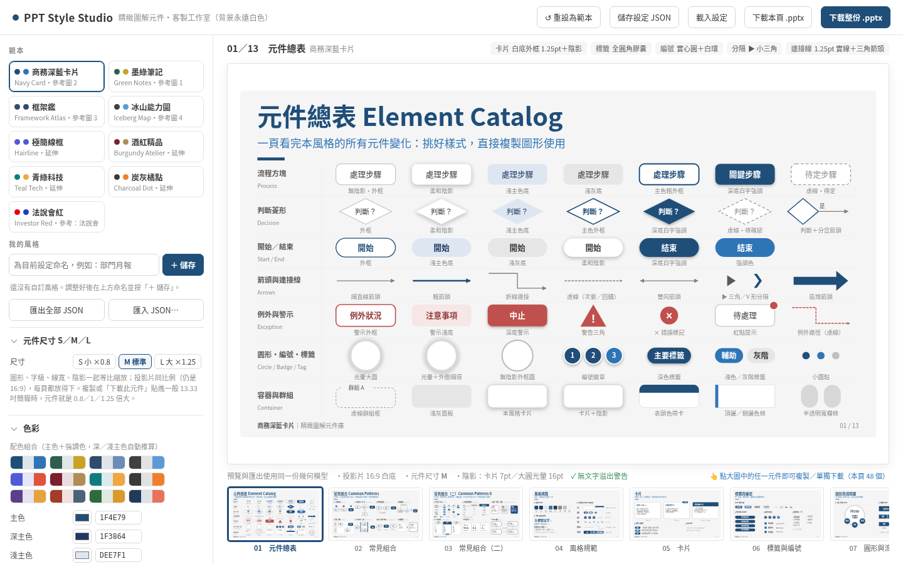

**01 元件總表**：看第一頁就能挑風格（9 種範本的總表，LibreOffice 實際輸出）：

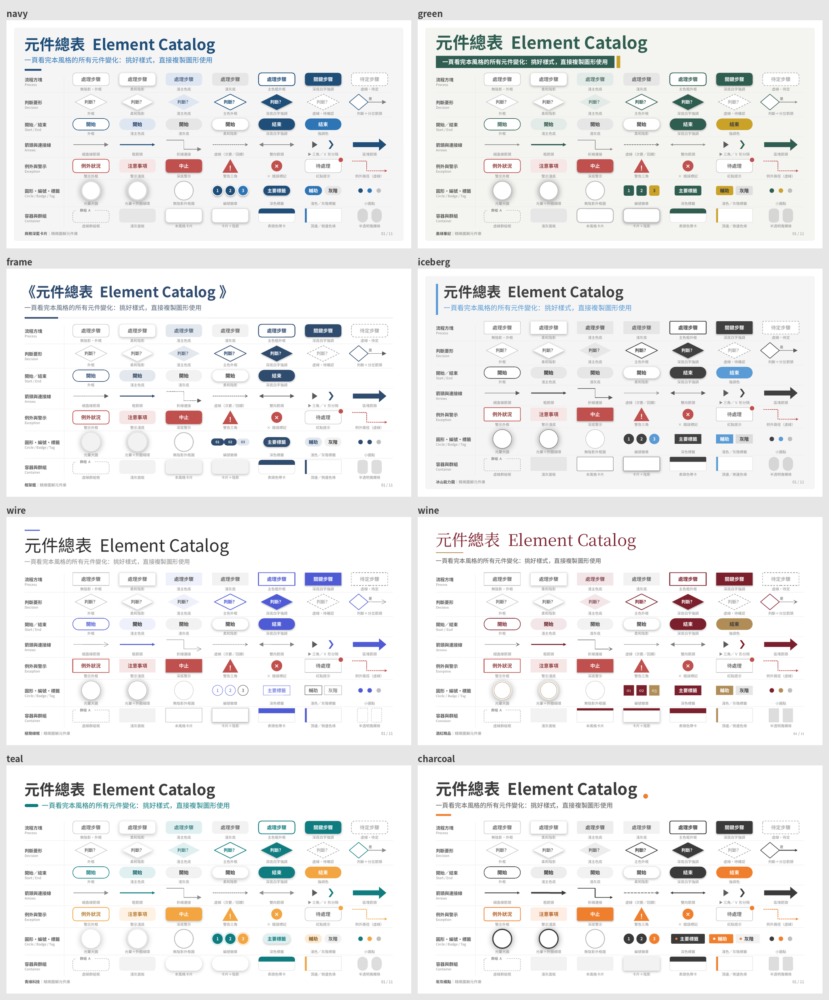

**02 常見組合**：已排好、已連線的流程小組合，每組在 pptx 裡是一個群組：

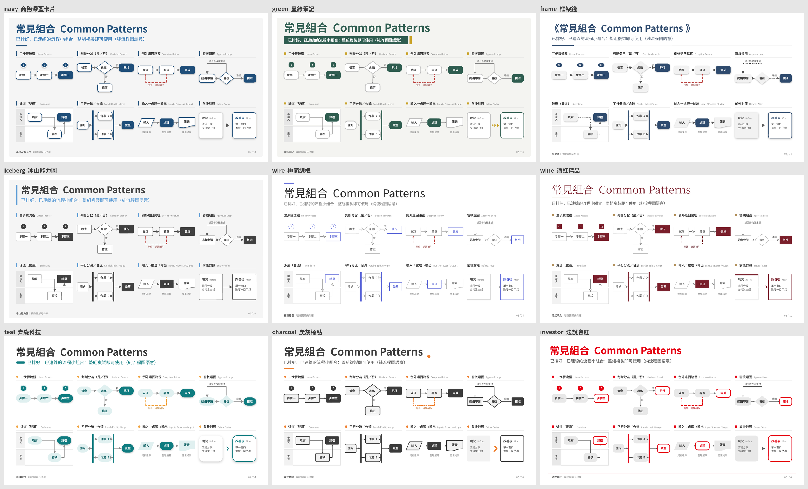

**03 常見組合（二）**：RACI 分工表、改善前後對照表、問題→原因→對策、三方案比較、KPI 數字卡、PDCA 循環：

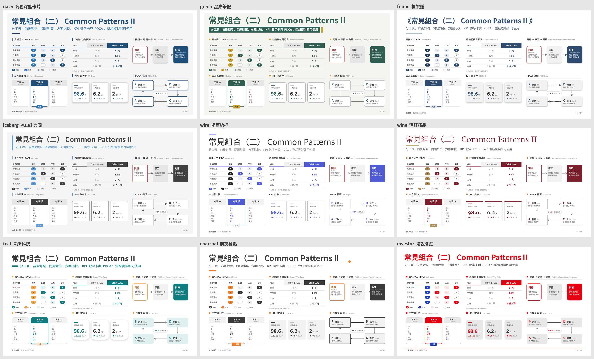

| 點選 PDCA 整組複製／下載 | 元件尺寸 S／M／L |
|---|---|
| 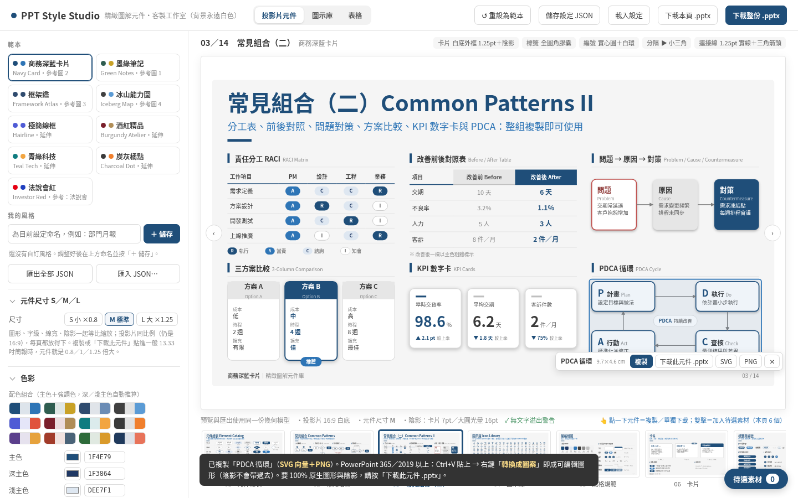 | 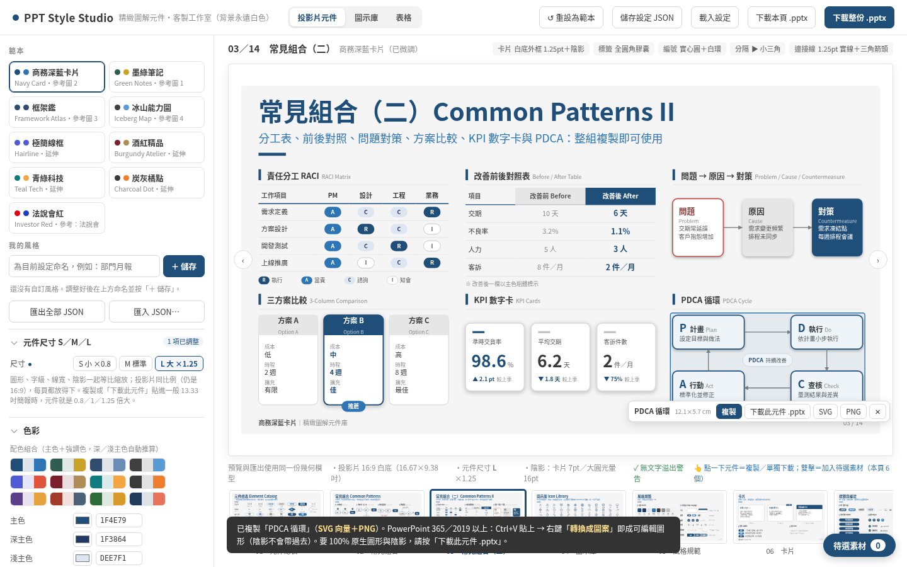 |

S／M／L 對照（上：整頁；下：同一個 PDCA 元件下載後放在標準 13.33 吋投影片）：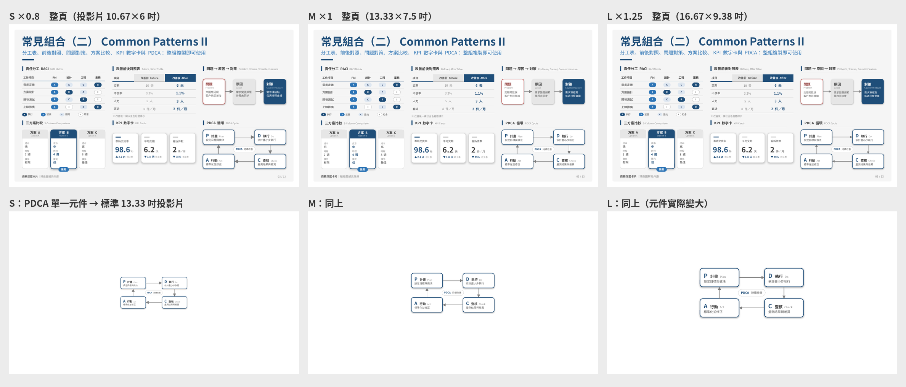

| 元件工具列（v9 起：按「複製」才複製） | 我的風格 |
|---|---|
| 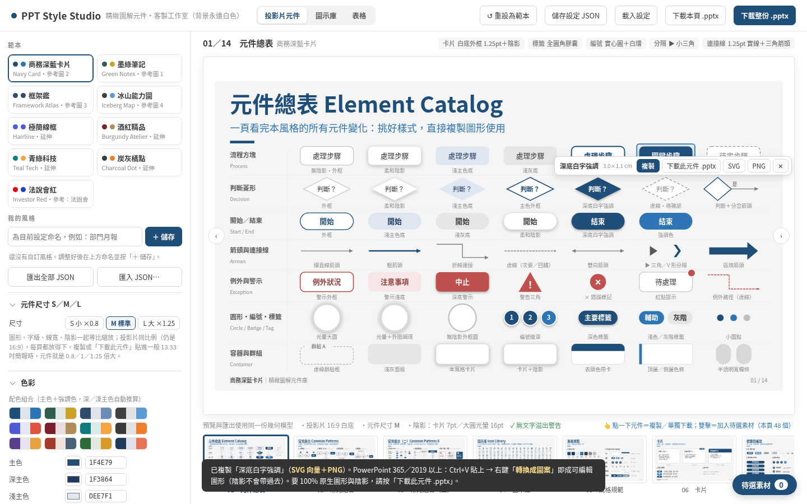 | 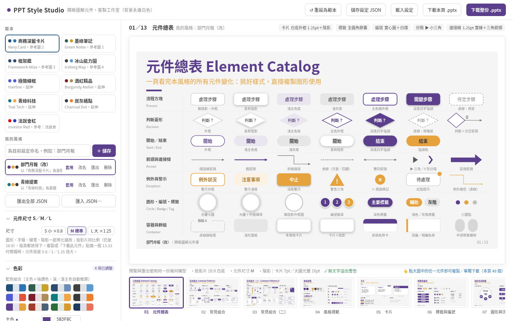 |

| 自訂配色 | 法說會紅 Investor Red |
|---|---|
| 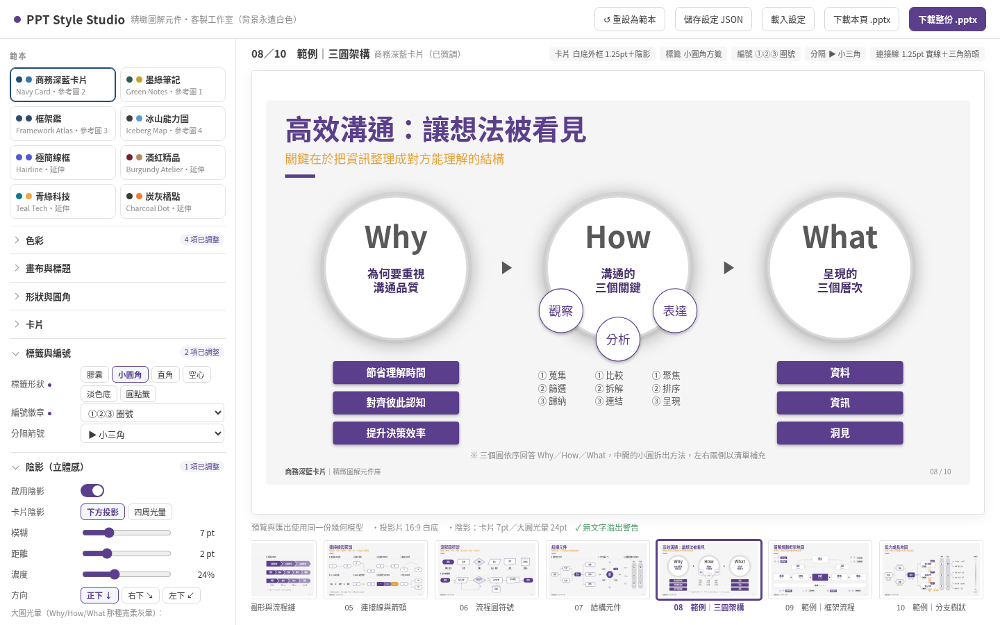 | 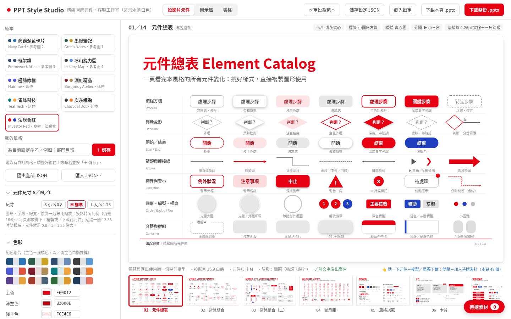 |

陰影修正前後（v3 → v4 → 即時預覽）：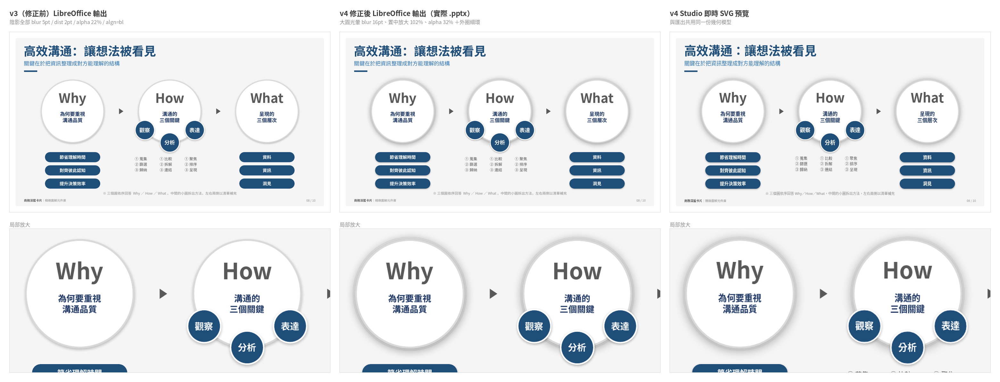

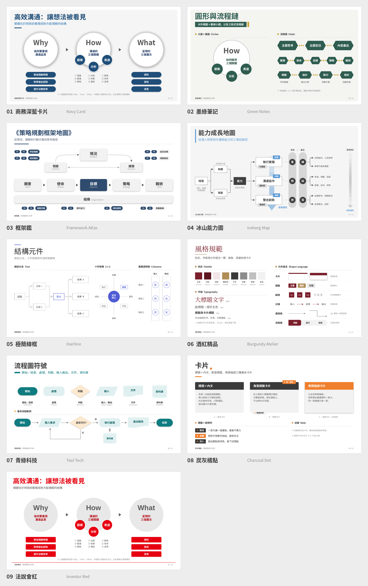

## Icon 元件與底座變體

**先選圖示、一次下載完整元件組：** 開啟「圖示庫」→ 點選任一圖示 →「下載底座＋組合元件 (.pptx)」。第一頁包含 24 款底座（4 種形狀、4 種外觀與 6 種狀態的代表款），第二頁包含 9 種組合。兩頁共 40 個圖示位置全部使用剛選的圖示，每款獨立群組，底座、圖示、文字及連接線均為原生可編輯內容，不是圖片。檔名與頁面標題包含所選圖示的中文名稱。

元件組使用點擊下載時的風格、尺寸及圖示字重，保留各款既有語意配色；圖示庫的單圖顏色／底樣式只影響既有 SVG／單圖 PPT 等下載。匯出不會覆寫 A13／A14 已儲存的編輯、待選素材或收藏。製作中按鈕會暫停，避免重複下載；即使切換圖示，已開始的下載仍使用當時選取的圖示。

「投影片元件 → A 基礎元件」新增 A13 Icon 元件與 A14 Icon 底座變體，原有 70 頁保持不變。也可在目錄搜尋「圖示元件」或「底座」。

- A14 有 24 個可獨立下載的起點：一般、成功、注意、警示、危險、停用六種狀態 × 線框透明、淡色底、實心底、淡底＋線框四種外觀。點元件 →「換圖示／底色」，可選圓角方塊、圓形、膠囊、六角形，合共 96 種搭配。
- 外觀控制即時預覽，棋盤格表示透明區域。「只有線框」是真正無填色，不是白底。實心底會自動選擇高對比的白色或深色圖示。
- 只有「一般」跟隨品牌主色；其餘語意色固定。狀態名稱會同步更新，不只靠顏色傳達意義。換圖示不會替換其他元件；取消不儲存尚未套用的樣式。
- 九款組合：圓角方塊＋文字、圓形徽章、外框圖示卡、橫向膠囊、圖示＋標題＋說明、圖示 KPI 卡、圖示步驟列、里程碑時間軸、警示與狀態卡。支援全部九種風格。
- 點元件 →「換圖示／改字」→ 每個圖示各自「搜尋換圖示」。沿用既有 521 個 Material Symbols 圖示庫，中文／英文搜尋，選完按「套用」才儲存。取消不改動原元件。
- 「下載圖示 SVG」只下載該列目前選取的圖示，透明背景、保留元件內圖示的顏色。白色圖示適合深底。需要其他配色可開啟既有「圖示庫」。
- 元件工具列的「下載單頁 .pptx（可編輯）」下載已組好的底座＋圖示＋文字。圖示是原生自訂圖形，不是嵌入圖片；取消群組後可分別編輯。瀏覽器的 SVG／PNG 下載仍沿用既有功能，PNG 不可編輯。
- 新頁與圖示挑選器也包含在離線單檔。圖示授權沿用 [Apache 2.0](LICENSE-material-symbols.txt)。

專項測試：`npm run test:icons`（含 `tools/icon_pack_test.js`）。離線事件測試：`STUDIO_HTML=PPT-Style-Studio.html node tools/icon_components_test.js --dom-only` 及 `STUDIO_HTML=PPT-Style-Studio.html node tools/icon_variants_test.js --dom-only`。DOM 測試涵蓋搜尋、逐一替換、取消、Escape、無結果、錯誤名稱、SVG 下載選擇、導覽及還原；不等於實際瀏覽器的排版／下載認證。

## v11 全站重構：A–G 分組、43 頁、求職與作品集、簡報食譜

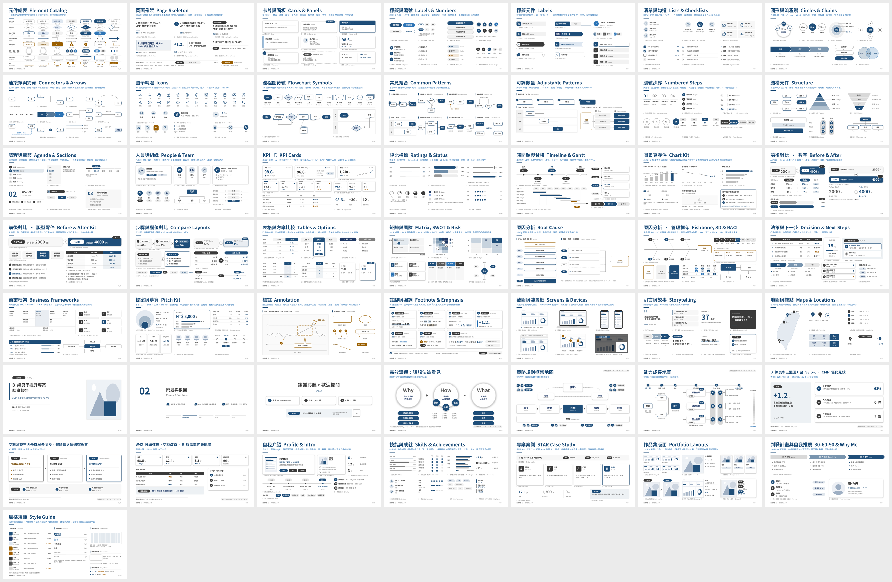

- **資訊架構**：00 總覽 → A 基礎元件 → B 流程與結構 → C 資料呈現 → D 對比與分析 → E 標註與強調 → F 範例與頁型 → G 求職與作品集 → X 附錄。每頁有頁碼（例：`C1 KPI 卡`），標題列顯示「B2 常用流程組合 · 11/43」。
- **左側分組側欄**：可折疊；搜尋支援同義詞（KPI／指標、比較／對比／VS、時間軸／里程碑、履歷／自我介紹…），點元件結果直接跳頁並選取該元件。手機版為抽屜（☰ 頁面／設定）。
- **深連結**：`studio.html#/D1/cmp`；記憶上次看的頁面 ID（不是索引），找不到就回 00 總覽。
- **新頁**：A0 頁面骨架、A2·3 清單、B3·2 編號步驟、B5 議程、B6 人員、C2 評比、C4 圖表佔位（→ SwiffChart）、D2·2 表格與方案比較、D4·2 魚骨／8D／RACI、D5 決策與下一步、E3 截圖與圖片框、E4 引言與故事、F4–F6 整頁範例（摘要／8D／週報）、G1 自我介紹、G2 技能與成就、G3 STAR 專案案例、G4 作品集版面。圖片框是真圖片，可右鍵「變更圖片」。新頁最小字 10pt。
- **簡報食譜**（上方分頁）：週報、8D、提案決策、求職面試、作品集、競賽、Kick-off、策略框架 8 套，點頁碼即跳到元件。
- **工具 ▾**：表格工具（新增 風險表／議題追蹤／行動項目／RACI 預設，標題跟隨主色、狀態欄＝燈號＋文字）、圖示庫、Style Kit、SwiffChart ↗、離線單一檔案、待選素材。
- 範例頁預設顯示，並列出「本頁使用元件」連結；預設畫布一律白底。

## v10 新功能：表格多重強調＋條件上色、標註元件（評審 R1-8、R1-9）

### 1. 表格：最多 3 個強調＋最多 3 條條件規則

| 工作室（強調 3 個＋條件 2 條） | 下載的 .pptx（LibreOffice 繪製） |
|---|---|
| 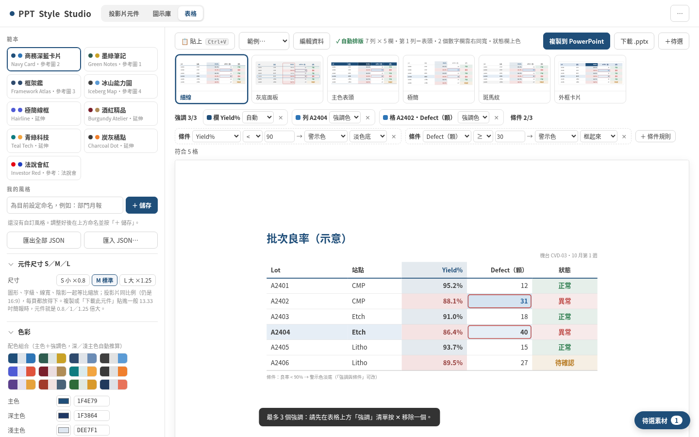 | 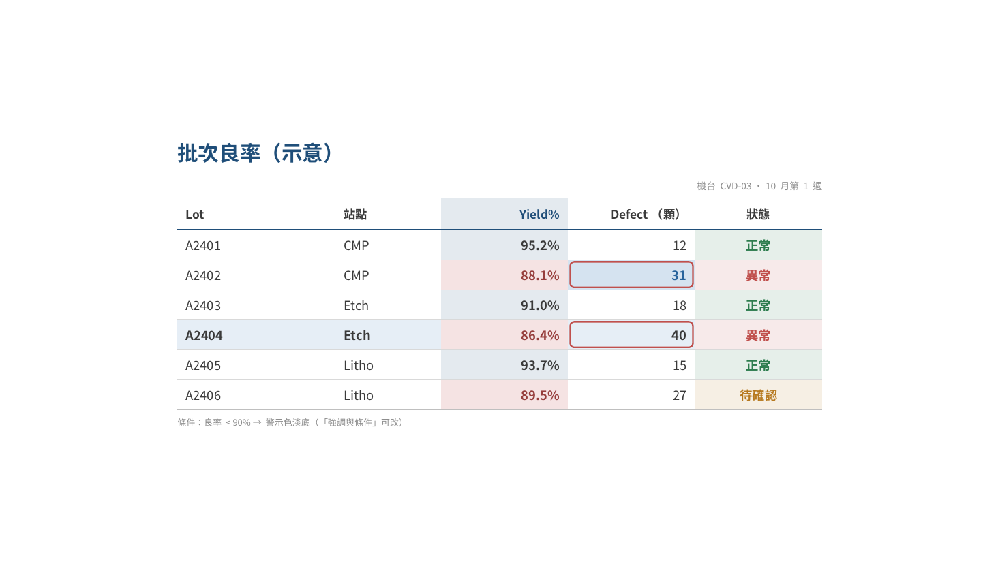 |

- 點表格：表頭＝「★ 強調此欄」、第一欄＝「★ 強調此列」、其他格＝欄／列／**「★ 強調此格」**。最多 3 個，第 4 個會提示先移除一個。
- 表格上方「強調」清單：每個強調各自選 **自動／主色／強調色／警示色**，✕ 移除。
- **條件規則**（「＋ 條件規則」）：數字欄＋比較（< ≤ > ≥ =）＋數值 → **警示色／良好（綠）／強調色**，方式 **淡色底／文字上色／框起來**。例如 `Yield% < 90 → 警示色 淡色底`、`Defect ≥ 30 → 框起來`。會即時顯示「符合 N 格」。
  數值解析：`95.2%`→95.2、`(86.4)` 與 `▼ 4.1` 視為負數、`1,234`→1234；不是數字的格子（例如「正常」）不會被規則套用。
- 範例資料多了「批次良率（條件上色）」。
- 同一份 model 用在：預覽、原生 .pptx（儲存格填色＋原生圓角框）、「複製到 PowerPoint」的 HTML（填色＋儲存格框線）、待選素材快照、可獨立搭配的 4 項外觀 × 9 種風格（`npm run test:table-appearance` 檢查 24 種組合，另保留 6 種舊外觀相容性）。
  「灰底面板」外觀的強調是圓角框（跟以前一樣）：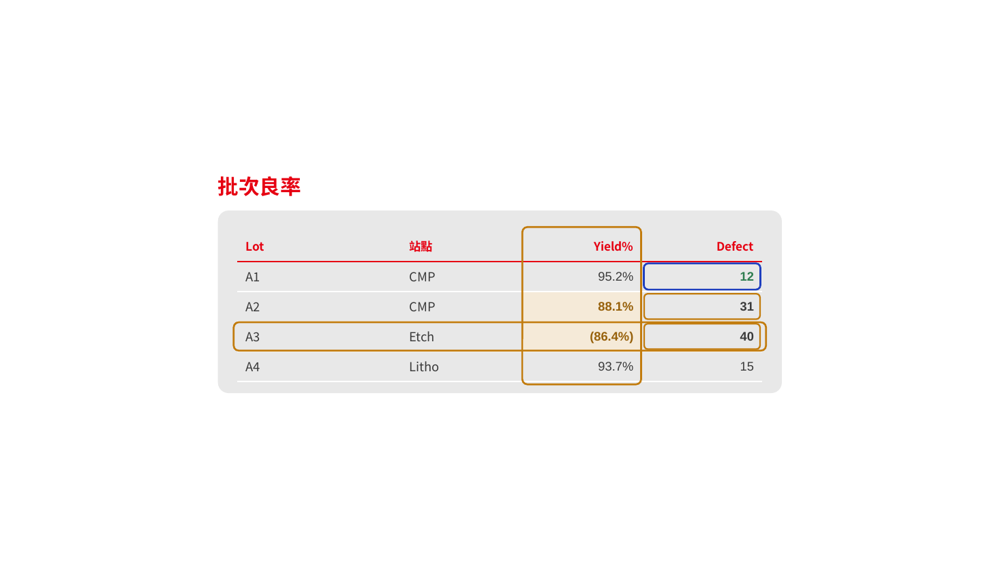
- 優先順序：條件規則的顏色 ＞ 單格強調 ＞ 列 ＞ 欄；狀態欄（正常／異常…）的顏色在強調時保留。
- 手機版也能用（清單自動換行）：[截圖](render/v10-mobile-table-marks.png)

### 2. 標註（06 頁＋元件總表新的一列）

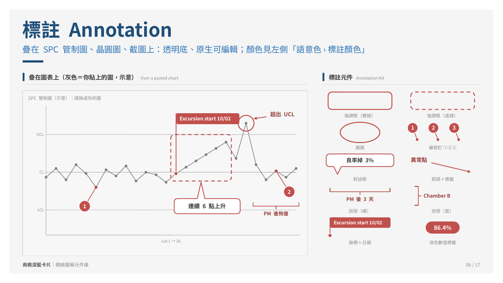

在貼上的 SPC 管制圖、晶圓圖、截圖上做記號的基本元素：**強調框（實線／虛線）、圈選、編號釘 ①②③＋引線、對話框（含尖角）、括號（橫／直）＋標籤、旗標＋日期（Excursion start 10/02）、箭頭＋標籤、深色數值標籤**。

- **透明底**：框、圈、括號、引線只有線條（無填色），蓋在圖上看得到底下的資料；只有對話框與旗標有底色（才看得清楚字）。
- **顏色**：預設 **警示色**（法說會紅會自動用琥珀色，見右圖）；左側「語意色・標註 › 標註顏色」可改成主色／強調色／深灰。 [法說會紅版本](render/v10-annot-slide-investor.png)
- 每個標註是一個群組（點選 → 複製／下載此元件 .pptx／＋待選），**改字**可改對話框、旗標、括號標籤、編號；S／M／L 與「最小字級」都適用。
- 06 頁左邊的灰色圖表只是示意佔位（也是一個群組，可刪）。實際疊在一張真的管制圖截圖上的樣子：
  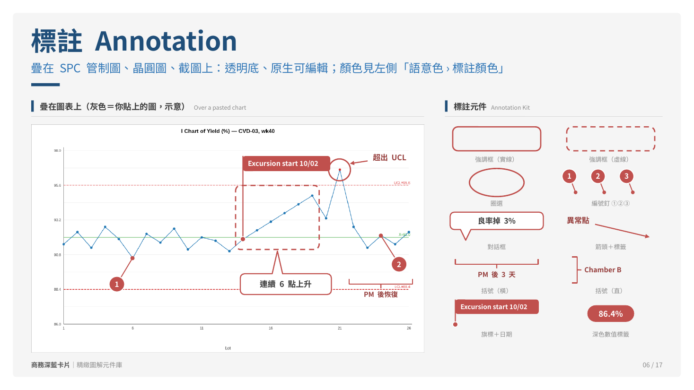
- 元件總表多了「標註 Annotation」一列（7 格）；總表列高自動略為收緊以放得下 8 列：[總表](render/v10-catalog-annot-row.png)

**限制**
- 標註是一般圖形，**不會跟著圖表的資料點移動**；換圖或改圖表大小後要自己對齊（建議先把截圖與標註一起「群組」）。
- 對話框尖角只能朝上或朝下；要朝左右請在 PowerPoint 裡拖曳尖角的端點（自訂圖形的端點編輯）或旋轉。
- 表格條件規則只比較**數字**；不能用文字條件（例如「狀態 = 異常」——狀態欄本來就會自動上色）、也不能跨欄比較（例如「實際 < 目標」）。
- 一格同時符合多條規則時只套用第一條；條件框（框起來）是蓋在表格上的獨立圓角框，表格列高被 PowerPoint 撐高時要手動對齊。
- 「複製到 PowerPoint」貼上的是原生表格：圓角框會變成儲存格框線（直角）；要圓角框請用「下載 .pptx」。

## v10 手機／平板版（≤ 900px）

**問題（v9 以前）**：版面只有桌機版——左側設定欄固定 340px、標題列不換行（最少約 796px 寬），手機（390px）上主預覽被擠到 **3×2 px**、整頁橫向溢出，打開只看得到設定欄，看起來像「手機不能看」（[修正前截圖](render/mobile-before.png)）。JS 本身沒有錯誤（Chrome 行動模擬與 WebKit 都沒有例外）。另外「⊕ 加入」「圖示 ＋」「左右換頁箭頭」只在滑鼠 hover 時出現、「雙擊加入待選」在觸控上不存在。

**現在**（螢幕寬 ≤ 900px 自動切換；桌機版面完全不變）：

| | |
|---|---|
| 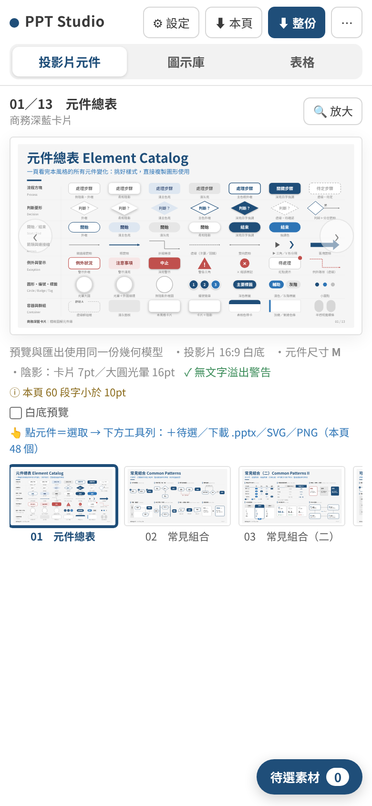 | 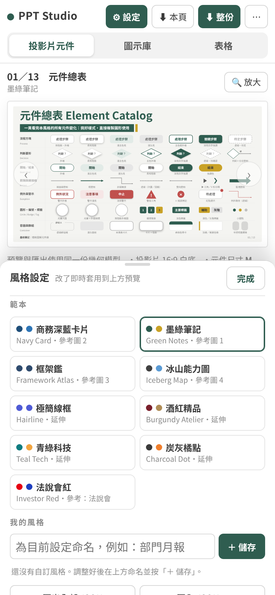 |
| 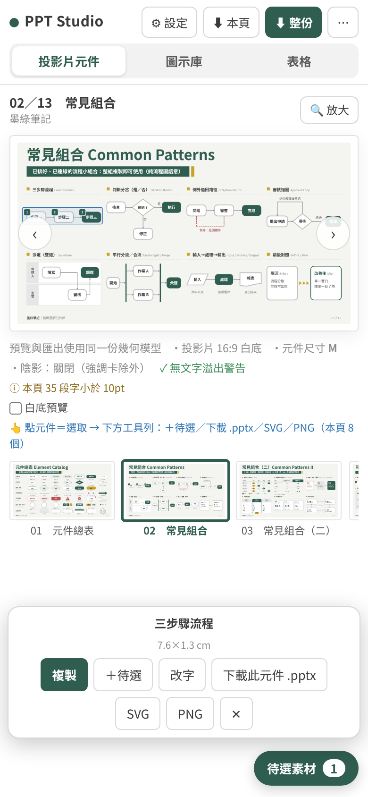 | 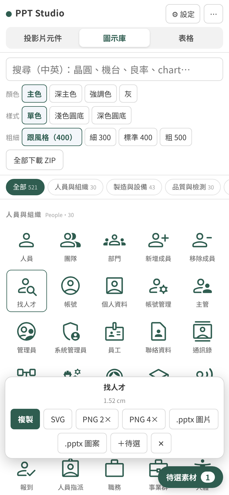 |
| 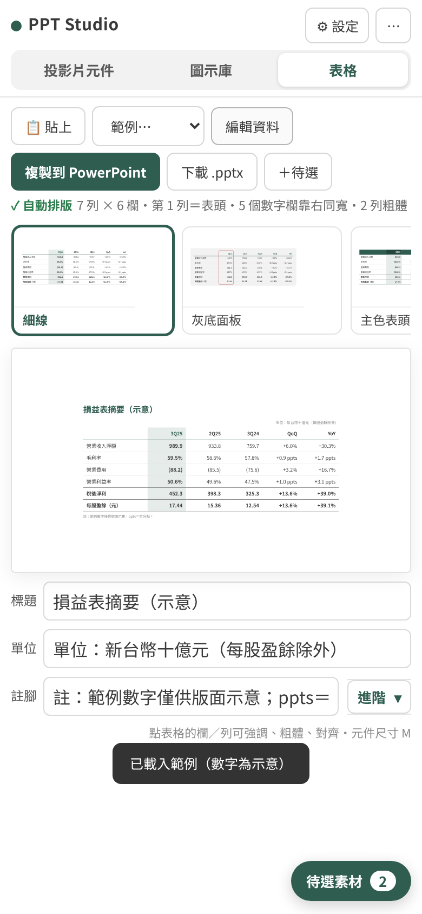 | 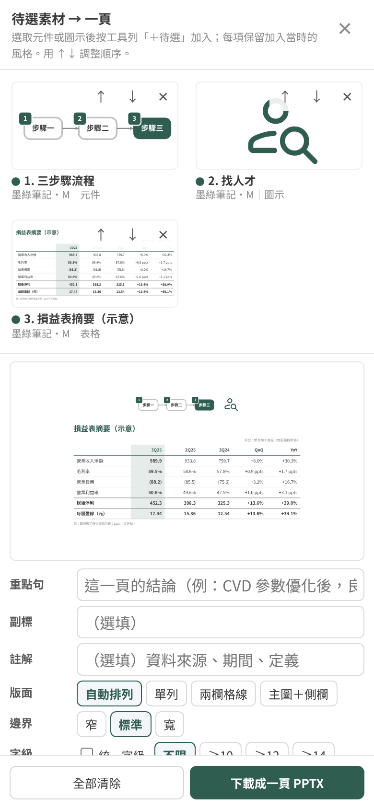 |

- 標題列精簡成兩行：「⚙ 設定」「⬇ 本頁」「⬇ 整份」「⋯」＋整排分頁；「含範例頁」移到 ⋯ 選單。
- 左側設定改成**下方抽屜**（按「⚙ 設定」開、按「完成」收），上方預覽仍看得到、改了即時套用。
- 預覽滿版（依寬度 16:9）；「🔍 放大」可 200% 左右捲動看細節；縮圖是可橫滑的一排；換頁箭頭常駐。
- **點一下＝選取**，工具列固定在畫面下方（複製／＋待選／改字／下載 .pptx／SVG／PNG）；觸控裝置不靠 hover、雙擊（雙擊不會誤加入）。
- 圖示庫：搜尋框滿版、分類列可橫滑、格線自動 5 欄（手機）／10 欄（平板）；點圖示後工具列在下方。
- 表格：工具列換行、編輯區上下排、預覽滿版；「貼上」被瀏覽器擋下時提示改用「編輯資料」長按貼上。
- 待選素材：全螢幕頁面，「下載成一頁 PPTX」固定在底部；用 ↑↓ 排序（觸控不支援拖曳）。
- 下載：iOS Safari 13+／Android Chrome 用 Blob 下載（blob 連結保留 60 秒，避免 iOS「下載？」確認前就失效）；不支援 `download` 的瀏覽器改開新分頁。在 LINE／Facebook／Instagram 內建瀏覽器開啟時，頂端提示改用 Safari／Chrome（LINE 直接給「用預設瀏覽器開啟」連結）。
- 載入：GitHub Pages 壓縮後約 **494 KB**；模擬慢速 4G（1.6 Mbps、150 ms）首次預覽約 3.2 秒（CPU 降速 4× 約 3.9 秒）。

**手機版限制**
- iPhone／Android 的 PowerPoint **不能貼上 SVG**，「複製」在手機上通常只會得到 PNG 圖片（不可編輯）；要可編輯圖形請用「下載 .pptx」→ 在「檔案 › 下載項目」點開 → 分享到 PowerPoint。
- iOS 的剪貼簿寫入需要使用者手勢；被拒絕時會提示改用下載。讀取剪貼簿（表格「貼上」）在 iOS 會跳出系統「貼上」按鈕，或改用「編輯資料」。
- 單頁元件很小時（例如 01 元件總表）手指不容易點準，請先「🔍 放大」或雙指縮放。
- LINE／FB 等 App 內建瀏覽器多半不能下載檔案，請改用 Safari／Chrome。
- 手機適合挑樣式、預覽、下載；細部調整（拖曳排序、大量改字）仍建議在桌機上做。

## v9 新功能（評審意見 #3、4、5、14、15）

| 項目 | 內容 |
|---|---|
| 待選素材 → 一頁組版 | 抽屜加寬成兩欄大縮圖（完整名稱，例如「流程方塊・深底白字強調」），下方是**一頁版面預覽**（與下載的 .pptx 相同）。可填**重點句**（當標題，沿用目前範本的標題樣式；太長自動縮字）、副標、**註解**（頁尾左下）；版面 4 種：**自動排列／單列／兩欄格線／主圖＋側欄**；邊界 窄／標準／寬；**統一字級**（選用：每項的主要字級對齊）；最小字級 ≥10／12／14（先放大再排版，放不下會提示）。檔名＝重點句。 |
| 可調數量 | 新的 **04 可調數量**：線性流程、泳道、問題 → 原因 → 對策，數量 2–6；新的 **05 原因分析**：直向 **5 Why** 追問（2–6 層）、**多因 → 問題**（人機料法環測 2–6 個，確認／排除是一般膠囊標籤，排除的線為虛線）。左側「數量」或選取元件後用工具列 **− ＋** 調整；全部是基本流程圖元件、連接線兩端黏著。 |
| 文字放不下 | 所有圖形與文字方塊都加 `<a:normAutofit/>`（PowerPoint 裡改長文字會自動縮小，不溢出）。工具列新增「**改字**」：只換文字、**不重排版面**；放不下時工作室先把字級縮小（最多到 60%），預覽與匯出一致；改過的文字存在本機，複製／下載／＋待選都會帶著。 |
| 語意色 | 新的「**語意色**」：警示色（自動＝主色是紅系時改用**琥珀色**，法說會紅、酒紅的警示不再與主色同色）、變好（綠）、變差（紅）。KPI ▲▼ 依「越高越好／越低越好」上色；表格狀態欄、負數也改用語意色。 |
| 最小字級 | 「字型與字級 › 最小字級」10／12／14pt：單一元件（複製／SVG／PNG／.pptx）與待選素材，若元件內最小字小於設定值，**整個元件等比放大**（工具列顯示「匯出 ×1.33（最小字 12pt）」）。整頁投影片不變，預覽上方會提示「本頁 N 段字小於 10pt」。 |

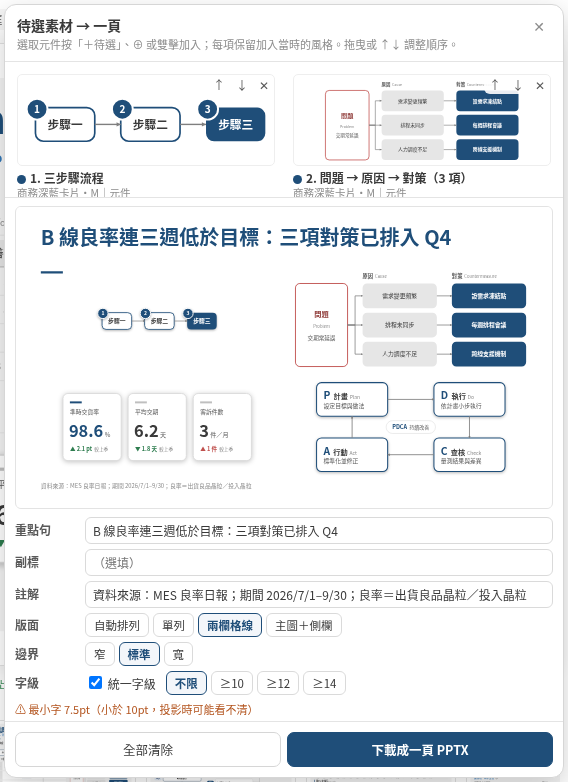

下載的一頁（LibreOffice 轉圖）：

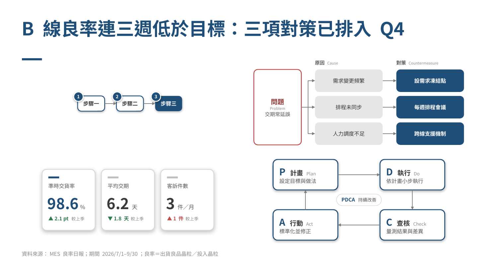

| 04 可調數量（navy 預設） | 05 原因分析（navy 預設） |
|---|---|
| 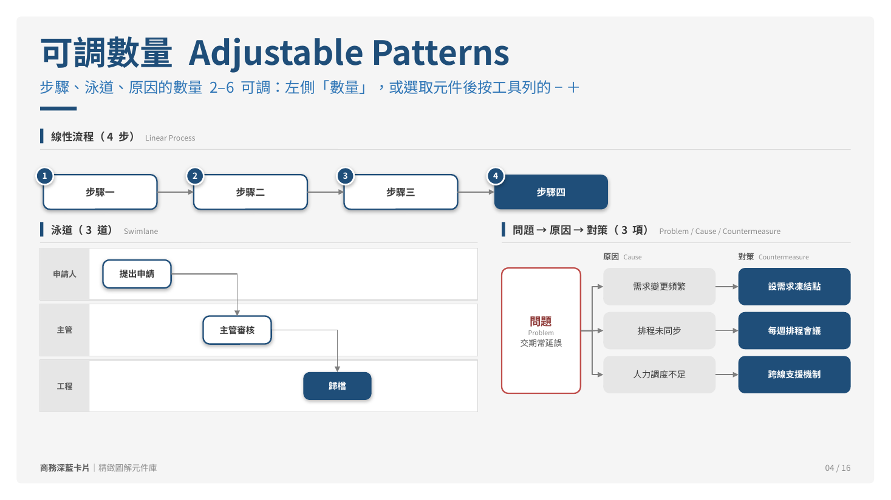 | 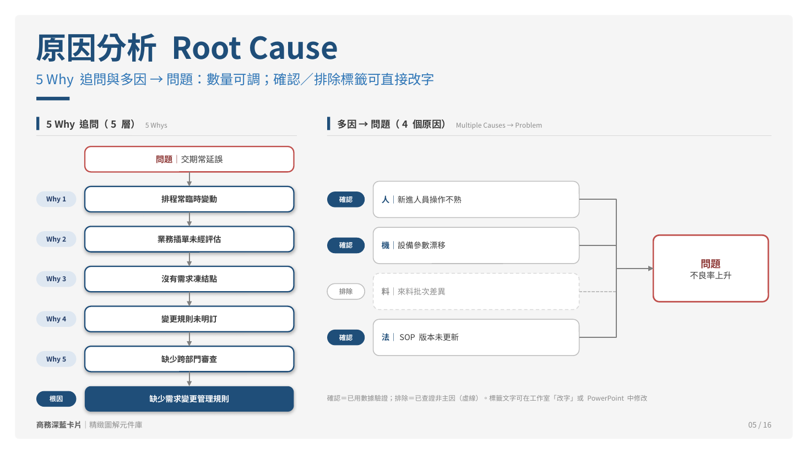 |

數量全部調到 6（法說會紅）：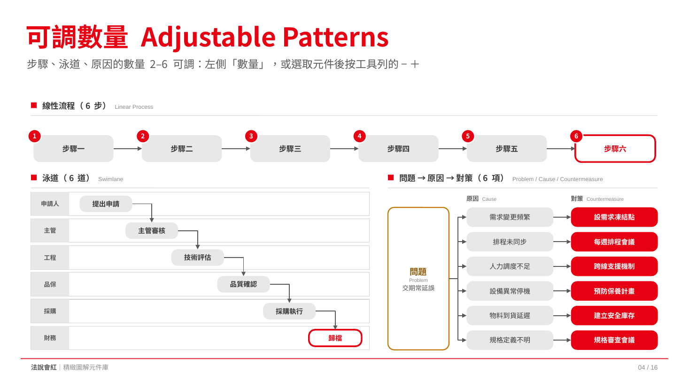

工具列 − ＋ 與改字：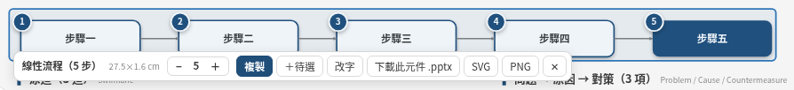 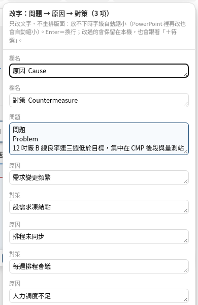

法說會紅的警示色與 KPI ▲▼（上：修正前；下：修正後）：

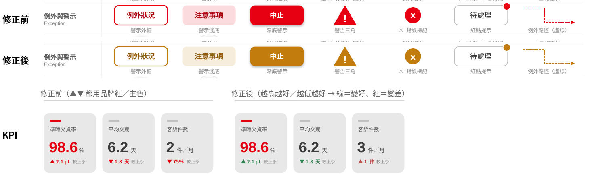

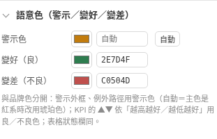 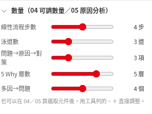

## v9 修正（評審意見 #1、2、6–13、16）

| 項目 | 改了什麼 |
|---|---|
| 字型與語言 | 每段文字都標 `lang="zh-TW"`，中文字型同時寫進 `latin／ea／cs`（`charset="-120"`），佈景主題的標題／內文字型也改成同一套；空白儲存格與段落結尾（`endParaRPr`）也帶字型 → PowerPoint 新打的字、空格輸入的字不會跑成新細明體或 Calibri。選 Noto Sans TC 時面板會提醒「不是 Windows 內建字型」。 |
| 點選與複製 | **單擊只選取**；工具列有「複製」與「＋待選」兩個按鈕；滑鼠移到元件右上角出現 ⊕ 直接加入待選；**雙擊＝加入待選（永遠不複製）**；同時出現兩個提示時以待選提示為準。圖示庫同樣：單擊選取、右上 ＋ 加入待選。 |
| 表格貼上 | 貼上新資料會清掉範例的標題／單位／註解（自己打過的會保留）；CSV 正確處理引號、逗號、`"1,234"` 千分位；控制字元一律去掉。 |
| 連接線 | 平行分流／合流的分流棒改成 3 段相接的細長方形，四條連接線**兩端都黏著**、線長是實際距離；圓柱（資料庫）用 1–4 號連接點。 |
| 匯入資料安全 | 文字中的 XML 非法控制字元（`\u0000` 等）在匯出前清除；匯入 JSON、我的風格、待選素材快照、localStorage 都經過 `sanitizeParams()`（顏色必須 6 碼 hex、數字有範圍、列舉值必須在清單內），擋掉 `"/>` 之類的注入。 |
| 頂列 | 不再換行（1280 寬也是一行）；重設／儲存／載入收進 **⋯** 選單；窄螢幕隱藏副標。 |
| 測試 | `npm test`：9 種風格 M＋表格／待選素材／單一元件測試檔 → `office validate`（嚴格 OOXML）＋`tools/check_pptx.py`（字型、lang、連接線兩端、id 等 PowerPoint 挑剔點），任何一項失敗即 exit 1。PowerPoint 365 人工檢查清單見下方。 |
| 函式庫 | 改用 `pptxgen.min.js`（PptxGenJS **3.12.0**）＋`jszip.min.js`（**3.10.2**），與 Node 版完全同版（package.json 鎖定），瀏覽器匯出的投影片 XML 與 `gen.js` 逐字相同；少 96 KB。 |
| 單一元件匯出 | 群組名稱等「遮線用底色」在單獨匯出時改成白色（投影片是白的，不帶畫布灰）；預覽右上有「**白底預覽**」切換，可看元件放在白色投影片上的樣子。 |
| 編號徽章與箭頭 | 三步驟流程的編號徽章改成壓在卡片左上角（帶白環），不再懸空；連接線箭頭改為 sm／med 兩級，預設 med。 |
| 範例頁與表格上限 | 範例頁（主題式版面，v9 起是 14–16 頁）改成**預設不含**，頂列「含範例頁」打勾才加入；表格最多 25 列（超過會提示並只放前 25 列），單欄最寬 45%（長文字欄自動換行並加高列高）；`studio.html` 的 `<script src>` 帶 `?v=雜湊`，改版後瀏覽器不會拿到舊的 deck.js。 |

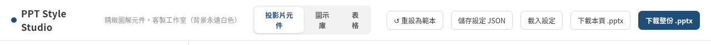
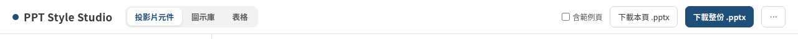

上：修正前（1280 寬換行）；下：修正後。

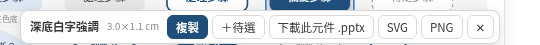 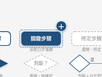

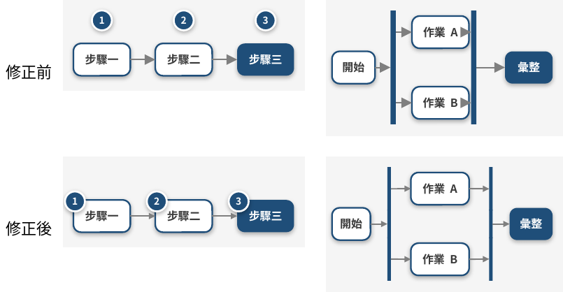

### PowerPoint 365（Windows）人工檢查清單
自動測試無法代替 PowerPoint 本身。每次大改後，請在 Windows PowerPoint 365 開啟 `out/test/` 的檔案，逐項確認：
1. 開啟時**沒有**「PowerPoint 發現內容有問題／修復」對話框（kit-*.pptx、table-*.pptx、tray.pptx、element*.pptx）。
2. 在任一文字方塊結尾按 Enter 繼續打中文：字型仍是微軟正黑體（不是新細明體）；校訂語言顯示「中文（台灣）」。
3. 在表格空白儲存格打字：字型是微軟正黑體。
4. 02 頁拖動「作業 A」：兩條連接線跟著走（兩端都黏著）；拖動分流棒時三段一起移動（同一群組）。
5. 02 頁三步驟流程：編號徽章壓在卡片左上角、箭頭大小適中。
6. 陰影柔和、無黑邊；群組可整組複製貼到別的簡報（尺寸不變）。
7. 長表格：依實際列高分成多頁，檢查第一頁／中間頁／末頁的表頭、原始資料、重點、頁碼與列範圍。字級與欄寬跨頁固定，合計只出現在真正的最後一列。單列或說明區太高時必須停用匯出，完整原始資料仍可下載 TSV。
8. element-catalog.pptx：群組名稱標籤的底色是白色。
9. 取消群組／重新群組正常；選取窗格中的名稱是中文且沒有亂碼。

## v8 新功能：圖示庫擴充到 521 個（Material Symbols Rounded）

**520 個 Google Material Symbols（Rounded，字重 300／400／500，與 v7 同一套）＋ 1 個自繪「晶圓」，分 18 類**，每個都有自然的中文名稱與中英搜尋關鍵字。

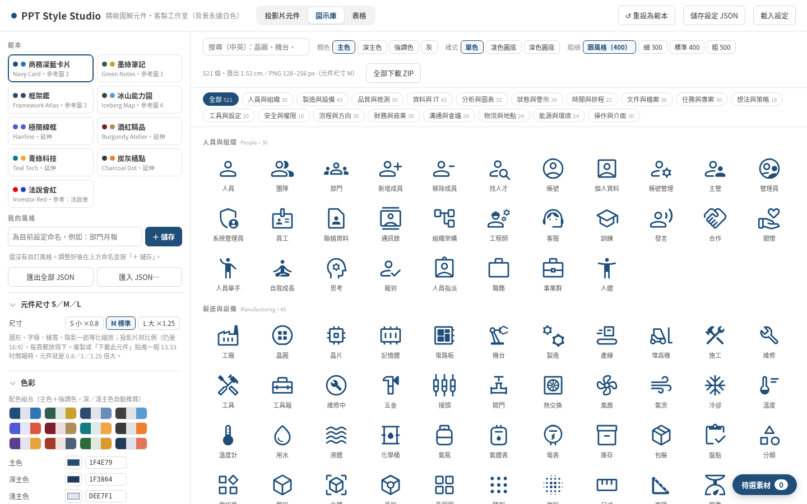

- **怎麼挑的**：
  1. 先依 Google Fonts 圖示 metadata（`fonts.google.com/metadata/icons`）的 **popularity** 排序（Rounded 共 3,925 個）；
  2. 從前 ~1,000 名中人工挑出跟半導體／製造／商業／IT 工作簡報相關的，寫進 [`tools/icon_list.txt`](tools/icon_list.txt)（分類、中文名稱、中文關鍵字），去掉寵物、餐飲、運動、遊戲、表情等消費／趣味類；
  3. [`tools/select_icons.py`](tools/select_icons.py) 每類依熱門度取前 N 個（上限見程式），製造／品質／半導體相關的（晶圓、機台、產線、檢測、晶片、閥門、氣瓶、潔淨室微粒…）不受上限；
     英文關鍵字取自 metadata tags，另外 [`tools/icon_kw_extra.txt`](tools/icon_kw_extra.txt) 補上工作常用詞（良率、成本、交期、供應商、KPI、製程、專利、審核、蝕刻、無塵室…）。
- **分類**（上方膠囊可直接跳到該類，捲動時會標示目前類別；搜尋時顯示各類命中數）：

| 類別 | English | 數量 |
|---|---|---:|
| 人員與組織 | People | 30 |
| 製造與設備 | Manufacturing | 43 |
| 品質與檢測 | Quality | 30 |
| 資料與 IT | Data & IT | 42 |
| 分析與圖表 | Analytics | 32 |
| 狀態與警示 | Status | 34 |
| 時間與排程 | Time | 22 |
| 文件與檔案 | Documents | 36 |
| 任務與專案 | Projects | 30 |
| 想法與策略 | Ideas | 18 |
| 工具與設定 | Settings | 20 |
| 安全與權限 | Security | 18 |
| 流程與方向 | Flow | 30 |
| 財務與商業 | Business | 30 |
| 溝通與會議 | Communication | 28 |
| 物流與地點 | Logistics | 24 |
| 能源與環境 | Energy & ESG | 24 |
| 操作與介面 | Actions | 30 |
| **合計** | | **521** |

- **搜尋**：中英、多個字（空白分隔＝都要符合）；名稱完全／開頭符合的排前面，命中最多的分類排第一。每次搜尋 < 0.1 ms（預先建好索引）。找不到時給建議詞。
- **效能**：圖示按鈕一次建好，但 SVG 只畫捲到附近的分類（IntersectionObserver）；換顏色／樣式／粗細只重畫看得到的分類。
- **檔案大小**：三種字重的路徑都保留官方形狀，座標整數化（960 網格 → 24 網格誤差 ≤ 0.0125，像素比對最大差 2%）後以相對座標重寫，再 DEFLATE＋base64 內嵌，
  載入時用 `icons.js` 內 40 行的同步解壓器解開（約 30–90 ms，不需要網路）。`icons.js` 約 410 KB；**單檔版 `PPT-Style-Studio.html` 約 1.09 MB**（v7 是 0.96 MB；不壓縮會是 ~1.9 MB）。
- **簡報圖示庫頁（v9 起是 06 頁）維持精選 118 個**（v7 那一套，一頁放得下且字還看得清楚）；標題寫「精選 118 個（Studio 共 521 個）」。其餘 403 個在工作室的圖示庫裡複製／下載／加入待選素材。
- 其他功能不變：顏色／樣式／粗細、點選後按「複製」放入 SVG＋透明 PNG、SVG／PNG／.pptx 下載、全部下載 ZIP（現在是 521 個 SVG＋521 個 PNG，約 12 秒、2.3 MB，按鈕會顯示進度）、雙擊加入待選素材。
- 重新產生：`python3 tools/select_icons.py <metadata 檔> <svg-400/rounded 目錄> && node tools/make_icons.js node_modules`。

| 跳到「品質與檢測」 | 搜尋「chart」 |
|---|---|
| 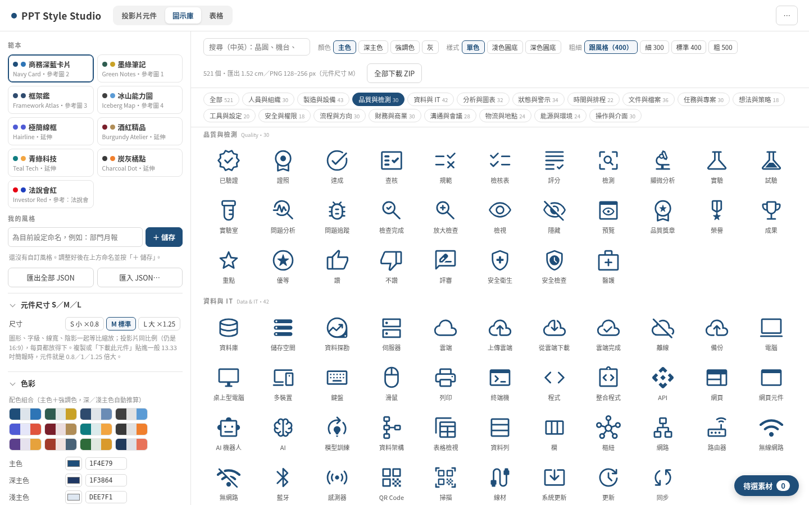 | 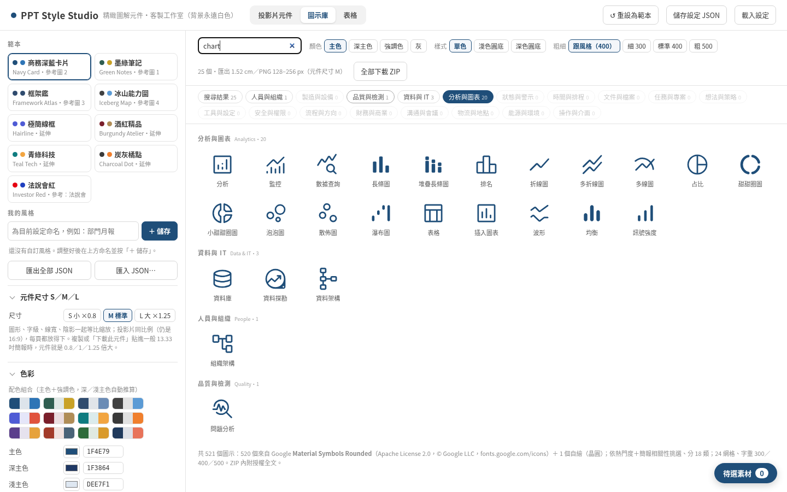 |

## v7 新功能：Material Symbols 圖示庫・重新設計的表格（＋v6 待選素材）

**圖示庫（上方「圖示庫」分頁）**：**118 個 Google Material Symbols（Rounded 圓角版）**＋ 1 個自繪「晶圓」，分 13 類（人員與組織、製造與設備、資料與 IT、分析與圖表、狀態、時間、文件、工具與思考、安全、流程與連結、財務、溝通、其他）。
搜尋支援中英關鍵字（例：晶圓、機台、風險、chart、PDCA）。顏色（主色／深主色／強調色／灰）、**粗細＝字重 300／400／500**（預設跟著風格線寬：髮絲線風格 300、粗線風格 500）、
S／M／L 全部跟著左側風格；三種樣式：單色、淺色圓底、深色圓底白色圖示。背景透明。

| 商務深藍卡片 | 酒紅精品（深色圓底、L） |
|---|---|
| 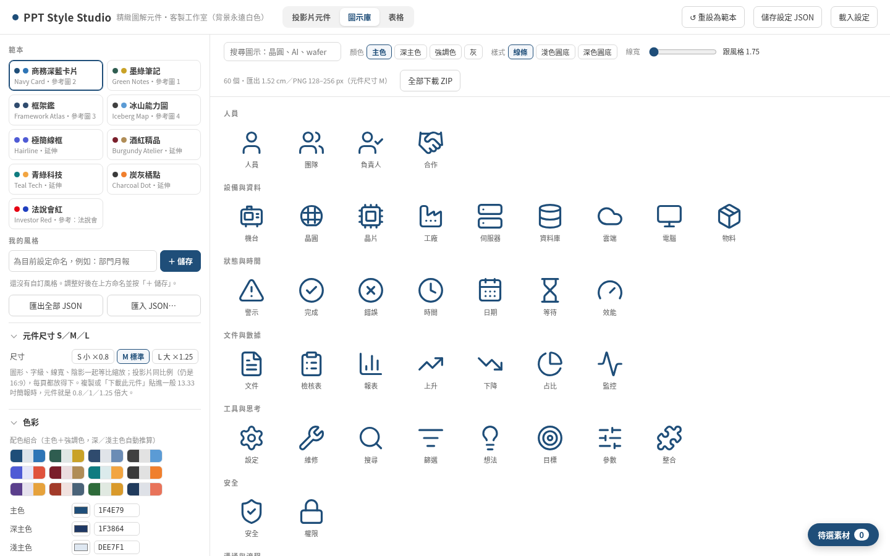 | 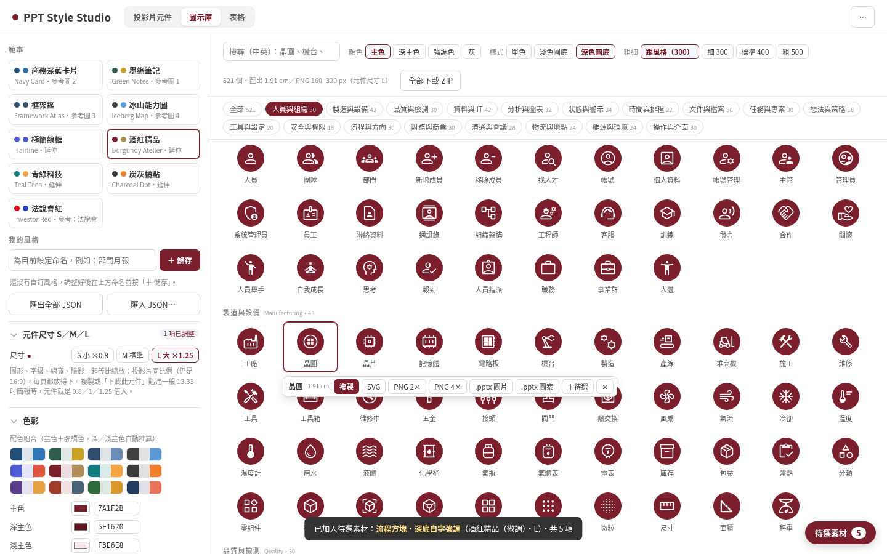 |

- **為什麼選 Rounded**：工作室的線條是圓頭線端、卡片多為圓角，Rounded 的圓弧轉角與它一致；Outlined 的直角轉折放在圓角卡片裡會顯得硬。
  全部只用一種（不混用 Outlined／Sharp），同一格線、同一字重，整張投影片的圖示看起來是一套。舊版 Lucide 線條圖示已整組換掉（避免兩種視覺風格混在一起）。
- Material Symbols 是「填色外框」字形：匯出成 PowerPoint 時是**一個填色自訂圖案**（可改填滿色），不是線條；粗細用官方三個字重的路徑切換，不是拉線寬。
- **點一下選取**並出現工具列（v9 起按「複製」才放入 SVG 向量＋透明 PNG；右上 ＋ 或雙擊＝加入待選）：SVG、PNG 2×／4×（透明背景）、**.pptx 圖片**（SVG＋PNG 備援，PowerPoint 365／2019 以上可右鍵「轉換成圖案」）、
  **.pptx 圖案**（原生可編輯圖案）、＋待選。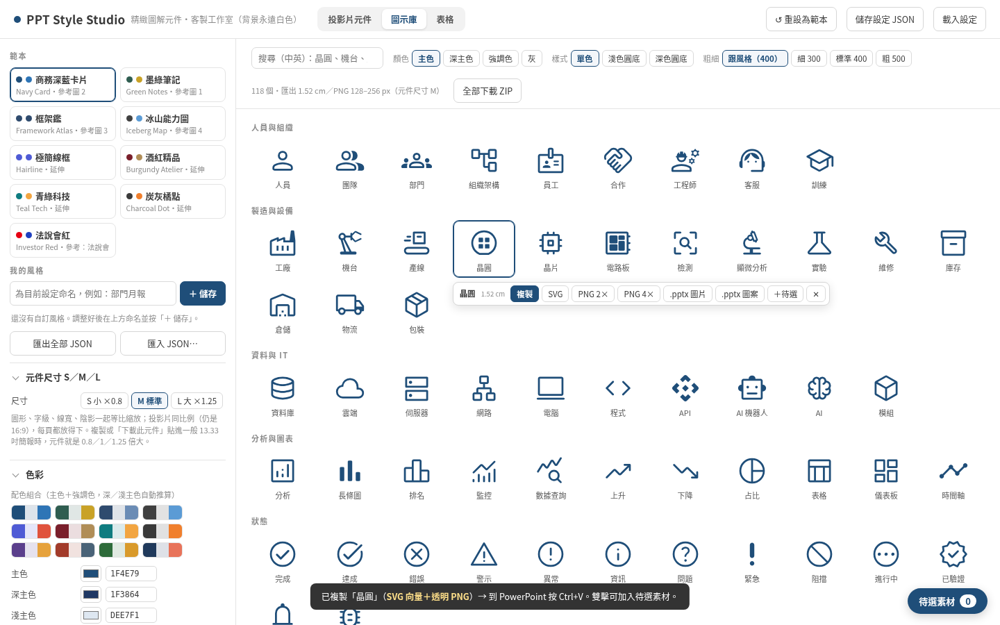
- **全部下載 ZIP**：`svg/` 118 個 SVG＋`png@2x/` 118 個透明 PNG＋`LICENSE-material-symbols.txt`（Apache 2.0 全文）。
- 簡報 **06 圖示庫** 頁（v8 時是 04 頁）：118 個圖示（原生圖案、每個是群組）＋「圖示＋文字」組合（圖示＋流程方塊、淺色圓底＋說明、深色圓底＋卡片、數字＋圖示、圖示流程＋黏著連接線）。
  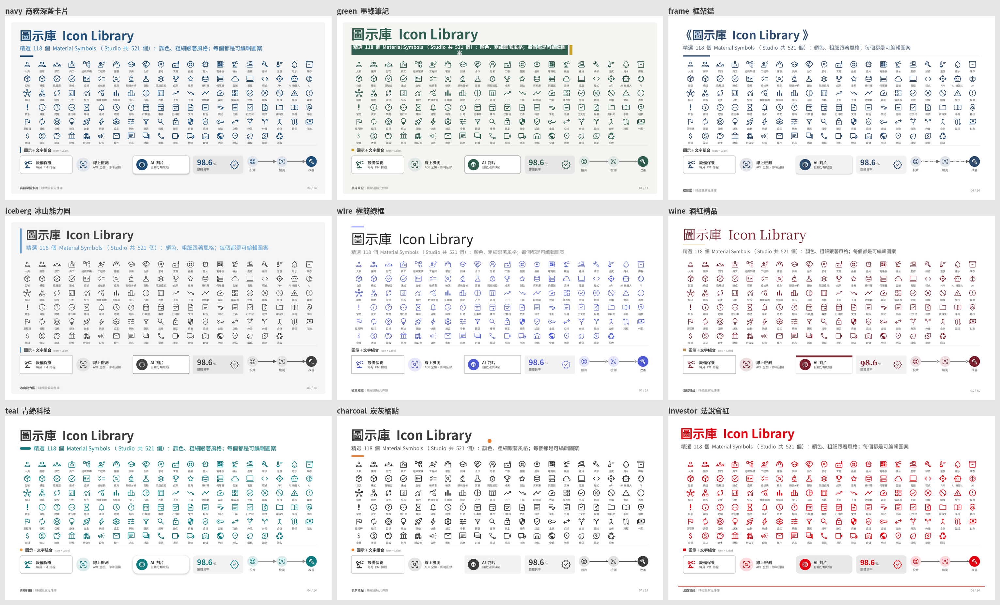
- 授權：Material Symbols © Google LLC，**Apache License 2.0**（[google/material-design-icons](https://github.com/google/material-design-icons)、[fonts.google.com/icons](https://fonts.google.com/icons)）；
  全文在 [`LICENSE-material-symbols.txt`](LICENSE-material-symbols.txt)、`icons.js` 與 ZIP。路徑形狀未修改（v8 起座標整數化到 960 網格、去掉 0 面積子路徑）。
  「晶圓」是自繪（Material 沒有晶圓；依同樣的 960 網格與三種字重畫外圈＋定位平邊＋2×2 晶粒）；舊的自繪「機台」改用 Material 的 `precision_manufacturing`。
  重新產生：`npm i @material-symbols/svg-300 @material-symbols/svg-400 @material-symbols/svg-500 && node tools/make_icons.js node_modules`。完全離線。

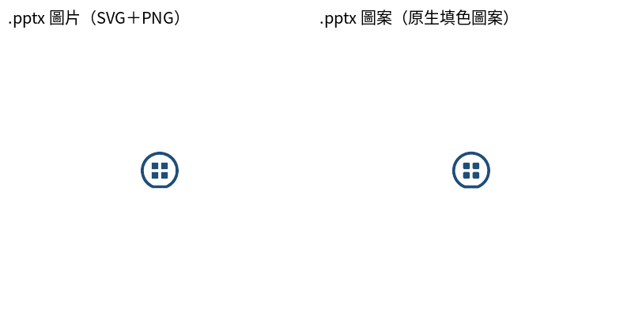

**表格（上方「表格」分頁，v7 重新設計）**——設計文件：[`review/table-redesign.md`](review/table-redesign.md)（三個方向的 mock：`review/table-mocks/`）。

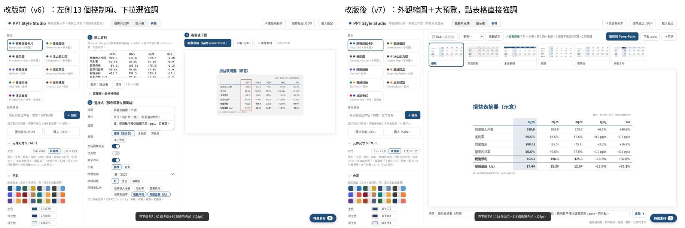

1. **資料工作台**：表格分頁上方的一級入口。大格子編輯與完整投影片同步預覽；A1、列號、欄字母顯示目前選取位置，格子與預覽雙向同步。小螢幕保留完整資料編輯，完成後返回投影片。
2. **貼上與匯入不改原始值**：支援 CSV／TSV 引號、格內換行、空白列、BOM。`A1,123` 是兩格，不再誤判為千分位。可以明確指定分隔符號；不等欄數會提示，未關閉引號及合併儲存格會拒絕匯入，避免資料錯位。
3. **新表格與更新資料分開**：「新表格」清除舊標題、單位及來源；只有明確選擇「更新這張表」才保留。沿用欄樣式獨立控制，不再把 CVD／MES 標題帶進新財報。
4. **原始文字與顯示格式分開**：自動只判斷對齊／狀態，不改 `00123`、`9007199254740993`、`1.123456789`。每欄可選文字／編號或數字；只有明確選「數字＋千分位」才加入分隔符，而且不經浮點數、不捨入。舊的小數位、百分比與門檻控制仍不重新啟用。
5. **在選取位置編輯**：插入上／下列、左／右欄，刪除選取列／欄，既有重點會跟著資料移動；可復原／重做。Enter 往下、Shift+Enter 往上、Tab 下一格、Alt+Enter 格內換行、Esc 取消本格修改；中文組字中的 Enter 不會跳格。
6. **六種外觀與原生輸出保留**：細線、主色表頭、卡片、主色表頭＋卡片、斑馬、只有細橫線。組合樣式同時保留彩色表頭與精緻卡片底板，固定使用白卡＋陰影，不另提供底色設定；欄寬拖曳、近看、自動放大、中文換行和重點操作維持。
7. **忠實顯示完整原表，不分頁**：所有原始列、欄與空白列都保留在同一張表。主工作區預設依寬度放大表格本體，長表向下捲動；切換外觀或重點／推薦／警告不會拆頁、隱藏資料或改動原始值。
8. **畫布留給表格，設定集中右側**：外觀、字型、密度、符號色與預覽選項都在右側。保留資料與外觀入口，移除「③ 重點」入口；點選儲存格即可直接在右側調整選取範圍與標示。選取虛線只用於編輯，不會匯出。
9. **原生 PPTX 為主要輸出**：工作台不提供 HTML 複製。「下載可編輯 PPTX」把完整原表放在單張自訂尺寸投影片，保留白卡／陰影與標題／單位／註腳，儲存格仍是 PowerPoint 原生可編輯表格。完整 TSV 保留原始值。若混合下載不同尺寸的素材，PPTX 整份簡報會使用最大畫布尺寸，其他素材只增加留白，不會縮小字級或物件；單頁組版不接受超出一般投影片的長表。
10. **超過 PowerPoint 尺寸限制才阻擋匯出**：完整表格仍在網頁顯示與編輯，不縮字、不截斷、不偷偷分頁。超出 PowerPoint 56 英吋的投影片尺寸上限時，清楚說明 PPTX 限制並保留完整 TSV；其他資料與重點操作照常。

相容性 API 保留 D.tableHtml／D.tablePageRows，但工作台不再提供剪貼簿輸出；完整原表僅有一個來源範圍。

表格專項測試：`npm run test:table`（原始值／原生 XML／完整性與 DOM 事件）及 `npm run test:table-ui`（需另備 Playwright 與 Chromium；可用 PLAYWRIGHT_MODULE／CHROME 指定路徑）。`--dom-only` 只驗證事件邏輯，不代表真實瀏覽器排版或剪貼簿通過。

| 點表格：浮動選單 | 預覽 vs 下載的 .pptx（LibreOffice 渲染） |
|---|---|
| 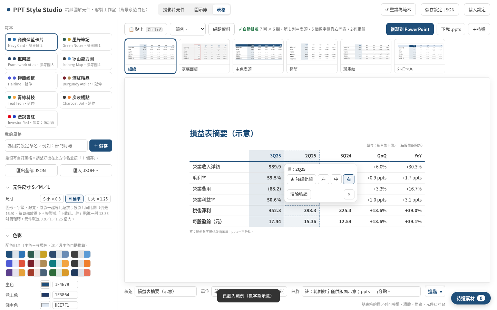 |  |

**待選素材（右下角「待選素材」按鈕）**：在任何元件、組合、圖示、表格預覽上**雙擊**就加入待選清單（跳出提示、按鈕數字＋1）。
每一項都會**凍結加入當下的完整風格**（顏色、圓角、陰影、線寬、S／M／L、我的風格、表格資料與設定），之後換風格不會改變它；
可以刪除單項、全部清除、拖曳或 ↑↓ 排序，存在瀏覽器 localStorage（重新整理不會消失）。
「**下載成一頁 PPTX**」：全部放在一張 16:9 白底投影片上，自動排版不重疊（太多時等比縮小），每項維持自己的風格、原生可編輯、各自成群組，連接線保持黏著。

| 待選清單（商務深藍＋酒紅 L 混合） | 下載成一頁 PPTX（LibreOffice 渲染） |
|---|---|
|  |  |

**關於舊的「表格美化工具」**（hctsaik.github.io/pptx-table-preview，未修改）：功能完整，但用起來卡在幾個地方——
① 自己一套配色（9 背景×6 標題色×8 強調色×3 強度＝1,296 組），和元件庫／我的風格無關，做出來的表格和簡報其他元件對不上，也存不成自己的風格；
② 一開始預覽是空白，選擇太多：24 張縮圖總覽＋右側 5 大區、四十幾個控制項，要捲很長才看得到全部；
③ 強調要在預覽上點格子，再從選單選類型，最多 2 種、有優先序規則，很難猜；沒有法說會那種「紅色圓角框框住一欄」與灰色圓角底板；
④ 另一個 repo＋Vite 建置，兩套工具要分開維護。工作室版本（v7）：貼上即完成、外觀縮圖、點表格強調，樣式直接用工作室風格。建議停用舊網站。

## 關於（v8）

商務圖解風格的 PowerPoint 元件庫＋**線上客製工作室**。**投影片背景永遠是白色**（可選擇加一塊極淺灰畫布面板），
所有元素都是 PowerPoint 原生、可編輯的圖形與文字（只有圖示的「.pptx 圖片」下載是 SVG＋PNG 圖片）。

## 一、客製工作室怎麼用
- **單檔版 `PPT-Style-Studio.html`**：所有程式（PptxGenJS、deck.js）都已內嵌，可單獨複製到任何資料夾、或在壓縮檔裡直接雙擊開啟。
- **開發版 `ppt-style-studio/studio.html`**：需要旁邊的 `icons.js`、`deck.js`、`jszip.min.js`、`pptxgen.min.js`，**請先把整個壓縮檔解壓縮**再開啟；
  若缺檔，頁面會顯示提示而不是空白。修改 `studio.html`／`deck.js` 後，執行 `python3 tools/build_single.py` 重建單檔版。

1. 雙擊 `studio.html`（或 `index.html`，會自動跳轉）。完全離線、免安裝；建議用 Chrome／Edge。
   也可以執行 `python3 -m http.server 8765`，再開 http://localhost:8765/studio.html。
2. **左側：先選範本**（9 種風格）或「我的風格」，再展開各群組微調：
   - **元件尺寸 S／M／L**：×0.8／×1／×1.25。圖形、字級、線寬、陰影一起等比縮放，投影片也同比例（S 10.67×6 吋、L 16.67×9.38 吋，仍是 16:9），
     所以每一頁都放得下；預覽會縮放到視窗，看起來一樣，但工具列會顯示元件實際尺寸（cm）。把元件複製或「下載此元件 .pptx」貼進一般 13.33 吋簡報，
     大小就是 0.8／1／1.25 倍。設定會一起存進 localStorage、設定 JSON 與「我的風格」。
   - **色彩**：主色／深主色／淺主色、強調色（可關閉）、12 組配色、4 組灰階結構（中性／暖／冷／深黑），也可以逐一設定文字灰與線條灰。
     「自動推算」開啟時，改主色會一併算出深主色與淺主色。
   - **畫布與標題**：淺灰畫布開關與色調、標題裝飾（短色條、色塊、細線、直條、膠囊、純標題…）、標題顏色、《》括號、小節標記、頁尾細線。
   - **形狀與圓角**：卡片圓角、欄條圓角與樣式、流程鏈樣式、大圓樣式與框線、流程圖符號樣式。
   - **卡片**：白底外框／淺灰實心／白底無框（靠陰影）／實心表頭色帶／頂邊色條，外框粗細與顏色、角落標籤、角標顏色。
   - **標籤元件**（16 頁）：左＝圖示或 1–3 字短字（01／重點／A）、右＝標籤文字；11 款（方塊圖示＋灰條、方塊短字＋灰條、深色膠囊＋圖示徽章、外框膠囊＋編號、頁籤、箭頭旗標、缺口旗標、外框版、六角徽章標題、小尺寸 chips、直式清單）。選取 →「改字」可改文字，也可輸入圖示名稱（中／英）換成圖示庫任一圖示；全部原生可編輯圖形。預覽：`bash tools/labels_preview.sh` → render/labels-*.png；瀏覽器測試：`tools/labels_ui_test.js`。
   - **對比式排版**（17–18 頁）：As Was → To Be 基本元件 11 款——A 橫向對比＋×2、B 多指標對照（Δ +100%／−30%）、C 長條比較（長度依數字比例）、D 直式上下（下 V 箭頭）、E 大數字分割（細分隔線＋▲▼）、F 三步驟 現況→改善→目標、G Before／After 條列（痛點 vs 改善）、H 降幅（不良率 5%→1%、綠色 ↓80%）、I 左右欄 VS、J 時間軸前後（年份）、K 小尺寸 inline chips。選取 →「改字」改數字：只改數字時保留大數字＋小單位格式，倍數／增減徽章與長條長度自動重算（徽章本身改過字就不動）；勾勾圖示可換。預覽：`bash tools/compare_preview.sh` → render/compare-*.png；瀏覽器測試：`tools/compare_ui_test.js`。
   - **KPI 卡與評比指標**（19 頁）：A 單值大數字（期間＋燈號）、B 數值＋目標＋Δ▲▼（Δ 依數值／目標自動算）、C 數值＋迷你趨勢線（原生線條）、D 4 卡橫排（頂邊色條＋燈號）、E 細進度條＋%、F Harvey ball 0／25／50／75／100、G 粗進度條、H 紅黃綠燈號、I 1–5 點數。指標名（中英）、數值、單位、目標、Δ、燈號說明、期間皆可「改字」；改 %／4/5 → 進度條長度、Harvey 扇形、點數顏色自動重畫。
   - **時間軸與甘特**（20 頁）：A 水平里程碑（菱形＋日期膠囊、說明上下交錯）、B 週別甘特（灰＝計畫、強調色＝實際、虛線＝今天、里程碑菱形）、C 垂直時間軸（目前階段強調外框）、D 階段 V 形時程。
   - **2×2 矩陣與議程**（21 頁）：A 2×2 矩陣（中英軸標題、象限標題／內容、高亮一個象限、泡泡標籤）、B SWOT、C 議程清單（編號徽章＋目前章節高亮）、D 頁首章節標籤／麵包屑、E 章節分隔（大編號＋膠囊標題）。
   - **註腳與強調**（22 頁）：A 螢光底（PowerPoint 原生醒目提示，自訂 srgb 淡色依風格色推算）、B 前後值（舊值刪除線 → 新值，降幅徽章自動算）、C 放大數字、D 底線強調、E 星號徽章（圖示可換）、F 內文上標 ¹²、G 頁尾來源／註解列＋資料截止日。
   - 以上 19–22 頁一律白底（不畫淺灰畫布面板）、全部原生可編輯圖形；原生圖表不在本專案，06 標註頁的「圖表佔位」與工作室標題列附連結到 [SwiffChart](https://github.com/hctsaik/swiffchart-web-preview)。預覽：`bash tools/gap_preview.sh` → render/gap-<頁>-<風格>.png、render/gap-all-styles-<頁>.png；瀏覽器測試：`tools/gap_ui_test.js`。
   - **標籤與編號**：標籤形狀（膠囊、小圓角、直角、空心、淡色底、圓點籤）、編號徽章（實心圓、白環、光暈、空心圓、方塊、01 膠囊、①②③…）、分隔箭號。
   - **陰影（立體感）**：開關；卡片陰影「下方投影／四周光暈」、模糊、距離、濃度、方向；大圓光暈的模糊與濃度；外圈細環。
   - **線條與箭頭**：粗細、顏色、實線／點線／虛線／長虛線、箭頭（三角／開放／燕尾／圓點／無）、起點樣式、箭頭大小。
   - **字型與字級**：標題／內文字型（微軟正黑體、微軟正黑體 Light、新細明體、Noto Sans TC、Arial）、數字字型、標題／標籤／註解字級與粗細。
   - 每個被改過的項目旁會出現小圓點，群組標題顯示「N 項已調整」。
   - **沒有「背景色」選項**：背景固定白色，這是設計規則。
3. **中間：即時預覽**。大圖＋下方 13 張縮圖（勾選頂列「含範例頁」會加上 14–16 範例頁）（開啟時預設顯示 01 元件總表）（點縮圖或用鍵盤 ← → 換頁）。預覽與匯出使用**同一份幾何模型**，
   包含柔和陰影與光暈；下方狀態列會顯示文字可能換行／溢出的警告。
4. **右上：**
   - 「下載整份 .pptx」：在瀏覽器內直接產生 14 頁簡報（含範例頁時 17 頁）（含陰影、群組與黏著連接線的 XML 修補）。
   - 「下載本頁 .pptx」：只輸出目前這一頁。
   - 「儲存設定 JSON」／「載入設定」：保存、分享自己的風格；JSON 內含 `changed`（與範本不同的項目）與完整 `params`。
   - 「↺ 重設為範本」：捨棄微調。瀏覽器會自動記住上次的設定（localStorage）。
5. **單一元件複製**（大圖上的每個元件、每個常見組合都可以點）：滑鼠移上去會出現藍色虛線框與右上角 ⊕（加入待選），**點一下選取**並跳出小工具列（v9 起單擊不再自動複製；雙擊＝加入待選）：
   - **複製**：同時放入 **SVG 向量**與 **PNG** 兩種格式（瀏覽器不支援 SVG 剪貼簿時只放 PNG）。
     PowerPoint 365／2019 以上（Windows）按 Ctrl+V 會貼成「SVG 圖形」，**右鍵 → 轉換成圖案**（或「圖形格式 › 轉換成圖案」）後就變成可編輯的形狀與文字方塊；
     為了相容，複製的 SVG 已把箭頭畫成實體三角形、去掉模糊陰影、背景透明。貼到不支援 SVG 的程式（舊版 Office、LINE、Word 2016 以前）會得到 PNG 圖片。
   - **下載此元件 .pptx**：只含這一個元件（或整個組合）的 1 頁簡報，置中擺放，**100% 原生 PowerPoint 圖形**，多個圖形已**群組**、陰影已修補；
     打開後點一下 → Ctrl+C → 貼到你的簡報即可。這是最可靠的「可編輯」途徑。
   - **SVG／PNG**：直接下載檔案。
   - 若瀏覽器拒絕寫入剪貼簿（例如權限、舊瀏覽器），會跳出提示並請你改用「下載此元件 .pptx」。
6. **我的風格**（左側「範本」下方）：把目前所有設定（顏色、圓角、陰影、線條、標籤、字級…）命名後按「＋ 儲存」；
   清單中可**套用、改名、匯出、刪除**；「匯出全部 JSON」「匯入 JSON…」可以分享給同事（單一風格或整包都能匯入；相同內容不會重複）。
   儲存在瀏覽器的 localStorage：單檔版（file://）與線上版各自獨立，換瀏覽器或清除網站資料會消失，**重要的風格請匯出 JSON 備份**。
   JSON 格式與「儲存設定 JSON」相同（`base`＋`changed`＋`params`，多一個 `name`）；整包是 `{"type":"my-styles","styles":[…]}`。

## 二、9 種範本（差異在形狀語言，不只是顏色）
| 範本 | 特色 |
|---|---|
| 商務深藍卡片 navy | 淺灰畫布、白色大外框圓＋寬柔光暈與外圈細環、深藍膠囊白字（柔和投影）、▶ 小三角分隔、漸層 V 形箭號 |
| 墨綠筆記 green | 暖灰畫布、2.25pt 粗灰框扁平卡片（無陰影）、墨綠小圓角方籤＋芥末黃、六角形鏈＋▶▶▶ 點狀箭號 |
| 框架鑑 frame | 純白、淺灰實心圓角卡＋柔和投影、中英雙語標籤、01 02 數字膠囊、點狀折線／曲線箭頭、《》標題 |
| 冰山能力圖 iceberg | 炭灰細框直角卡＋角落緞帶、半透明寬欄條上的圓點、細折線樹狀、淺藍漸隱大箭頭 |
| 極簡線框 wire | 全部 0.75pt 髮絲線、無填色無陰影、細字標題、空心編號、開放箭頭 |
| 酒紅精品 wine | 直角、頂邊色條卡片、明體細標題＋金色細線、方形襯線數字、燕尾箭頭 |
| 青綠科技 teal | 全圓角膠囊與大圓角卡、較深柔和陰影（模糊 10pt）、大圓光暈 18pt、淡青底標籤、光暈編號 |
| 炭灰橘點 charcoal | 炭灰實心表頭卡、2pt 粗線、橘色圓點標記、區塊 V 形箭號、粗黑標題＋橘點 |
| 法說會紅 investor | 參考法說會簡報：純白底、左上大號粗體紅標題（#E60012）、淺灰大圓角面板承載內容、紅色外框框出重點、紅色小方塊項目符號、底部細紅線＋灰色小字頁尾；平面、幾乎無陰影，藍色（#1F3FBF）只作次要強調 |

每個範本 25 頁：**01 元件總表**　**02 常見組合**　**03 常見組合（二）**　**04 可調數量**　**05 原因分析**　**06 標註**（v10）　**07 圖示庫**　08 風格規範　09 卡片　10 標籤與編號　11 圓形與流程鏈　12 連接線與箭頭
13 流程圖符號　14 結構元件　15 版型｜As Was／To Be　16 標籤元件　17 對比式排版　18 對比式排版（二）　19 KPI 卡與評比指標　20 時間軸與甘特　21 2×2 矩陣與議程　22 註腳與強調　23 範例｜三圓架構（Why／How／What）　24 範例｜框架流程　25 範例｜分支樹狀＋寬欄（23–25 範例頁在工作室預設不含）。

**01 元件總表 Element Catalog**：一頁看完本風格的所有元件變化，看第一頁就能挑風格。每一列是一個類別（左側灰色雙語類別名），
每一格是一個變化，下方有小圖說：
| 類別 | 變化 |
|---|---|
| 流程方塊 Process | 無陰影外框、柔和陰影、淺主色底、淺灰底、主色粗外框、深底白字強調、虛線待定 |
| 判斷菱形 Decision | 外框、柔和陰影、淺主色底、主色外框、深底白字強調、虛線待確認、判斷＋分岔箭頭 |
| 開始／結束 Start/End | 外框、淺主色底、淺灰底、柔和陰影、深底白字強調、強調色（有強調色時） |
| 箭頭與連接線 Arrows | 細直線箭頭、粗箭頭、折線連接、虛線、雙向箭頭、▶ 三角／V 形分隔、區塊箭頭 |
| 例外與警示 Exception | 警示外框、警示淺底、深底警示、警告三角、× 錯誤標記、紅點提示、例外虛線路徑（警示色：強調色若為飽和暖色就沿用，否則用克制的磚紅 #C0504D） |
| 圓形・編號・標籤 | 光暈大圓、光暈＋外圈細環、無陰影外框圓、編號徽章、深色標籤、淺色／灰階標籤、小圓點 |
| 容器與群組 Container | 虛線群組框、淺灰面板、本風格卡片、卡片＋陰影、表頭色帶卡、側邊色條卡、半透明寬欄條 |

每個元件都是獨立、可編輯的 PowerPoint 圖形，圖說是另一個文字框，可以直接複製單一圖形貼到自己的簡報。
「柔和陰影」「光暈」等變化即使該風格關閉陰影也會示範（同樣經過陰影 XML 修補）；其餘變化完全跟隨左側參數。
由多個圖形組成的元件（警告三角＋驚嘆號、紅點提示、群組框＋名稱…）在 pptx 中已**群組**。

**02 常見組合 Common Patterns**（純流程圖語意，沒有金字塔／循環這類主題模板）：三步驟流程、判斷分岔（是／否）、例外退回路徑、
審核迴圈、泳道（雙道）、平行分流／合流、輸入→處理→輸出、前後對照。每一組在 pptx 中是一個**群組**（`<p:grpSp>`，名稱＝組合名），
點一下整組選取，按「複製」或下載；組合名稱與底線放在群組外。

**03 常見組合（二） Common Patterns II**：
| 組合 | 內容 |
|---|---|
| 責任分工 RACI | **原生 PowerPoint 表格**（4 項工作 × 4 角色，只畫橫線）＋ R／A／C／I 膠囊標記（R 主色、A 強調色、C 淺主色、I 空心）與圖例 |
| 改善前後對照表 | 原生表格：項目／改善前（灰）／改善後（主色表頭、主色粗體數值） |
| 問題 → 原因 → 對策 | 三個方塊（問題＝警示色外框、原因＝淺灰、對策＝主色實心），黏著連接線 |
| 三方案比較 | 三欄卡片，中間推薦方案以主色外框＋色帶表頭＋「推薦」標籤強調 |
| KPI 數字卡 | 三張卡：指標名稱、大數字＋單位、▲▼ 變化與比較基準 |
| PDCA 循環 | 流程圖畫法：Plan／Do／Check／Act 四個圓角方塊（字母＋中英標題＋一句說明），黏著連接線依序連成迴圈，中央小標籤「PDCA 持續改善」；不是插圖式的循環圖 |
除了兩個含表格的組合以外，每組都是一個 `<p:grpSp>` 群組（PowerPoint 不允許表格放進群組，所以 RACI 的表格與膠囊標記是並排的獨立物件；
在工作室中點一下照樣可以整組選取、複製／下載）。

**黏著連接線（v5.2）**：02、03 常見組合、04 可調數量、05 原因分析、07 圖示流程、12 連接線與箭頭、13 流程圖符號中，連接兩個圖形的線在 pptx 裡是真正的 PowerPoint 連接線
（`<p:cxnSp>`＋`<a:stCxn>`／`<a:endCxn>` 指向圖形 id 與連接點），**在 PowerPoint 裡移動方塊，線會跟著走**。
直線用 `straightConnector1`、L 形用 `bentConnector2`、Z／U 形用 `bentConnector3`（必要時加 rot／flip 與 adj1），保留原本的箭頭、線型與顏色。
連接點：矩形／圓角矩形／菱形／圓柱 0 上 1 左 2 下 3 右；橢圓 0 上 2 左 4 下 6 右；平行四邊形 0 上 2 右 4 下 5 左；文件改用內建 `flowChartDocument`（0 上 1 左 2 下 3 右）。
群組內的連接線與圖形在同一個 `<p:grpSp>` 裡，連結仍有效。每份 pptx 41 條：37 條兩端都黏、4 條只黏一端（平行分流／合流的分流棒上下分支，
起點不在分流棒的連接點上）；曲線箭頭、樹狀分支圖、範例頁的線維持一般線條。

`out/` 內有 9 份預先產生的 `kit-<id>.pptx`；`node gen.js --size S`／`--size L` 會在 `out/size/` 產生 S／L 版本（已預先產生 18 份）。

## 三、陰影（v4 修正）
v3 的陰影全部是 PptxGenJS 預設：模糊 5pt、距離 2pt、濃度 22%、對齊左下（algn="bl"），大圓和卡片一樣，
所以參考圖中那種「大圓四周寬而柔的灰色光暈」沒有出來。v4 改為：
- **大圓光暈**：模糊 16–18pt、距離 ≤2pt、正下方 90°、置中（algn="ctr"）、放大 102%、濃度 28–32%，可加 0.07 吋外圈淺灰細環。
- **卡片／膠囊投影**：模糊 7–10pt、距離 2–3pt、方向 90°（可改 45°／135°）、濃度 20–25%。
- **小圓／標籤**：模糊約 4–6pt、距離 ≤1.5pt。
PptxGenJS 無法寫出 algn／sx／sy，因此匯出後會用 JSZip 解開 pptx、逐一改寫每個形狀的 `<a:outerShdw>`（`rotWithShape="0"`），
再重新壓縮。形狀仍是原生、可編輯；在 PowerPoint「格式 › 圖形效果 › 陰影」中可以看到並修改這些數值。

**v5.1 陰影質感回復**：比對 v4（9faee6c）與 v5（d139647）後，舊有頁面（卡片、圓形、流程…）的 `<a:outerShdw>` 數值與 LibreOffice 渲染完全相同；
質感變差來自 v5 新增的「元件總表／常見組合」——16pt 大圓光暈直接套在 0.62 吋小圓上（模糊約占直徑 35%，成一團灰霧），
7pt 卡片投影套在 0.38 吋小方塊上，而且工作室一打開就是這一頁。v5.1 起陰影「隨尺寸收斂」：比舊頁最小尺寸還小的圖形，
模糊與距離按比例縮小（下限 42%），小圓光暈濃度略降；舊頁輸出與 v4 逐位元相同。工作室「陰影」區的「小元件收斂」可關閉（＝v5 原樣）。
比對圖：`render/shadow-compare-navy.png`、`render/shadow-zoom-navy.png`。

**OOXML 驗證**：匯出後另做結構修正（PptxGenJS 3.12 的已知缺陷）：段落內重複的 `<a:pPr>`、presentation.xml 中 `notesMasterIdLst` 的順序、
`[Content_Types].xml` 中不存在的 slideMaster 宣告、表格 `graphicFrame` 與其他圖形 id 重複。修正後 `office validate`（Transitional XSD＋OPC＋id 檢查）
對 9 種風格 × S／M／L 的整份 pptx，以及工作室下載的單頁／單一元件 pptx 全數通過。

## 四、程式架構與指令
- `icons.js`：521 個 Material Symbols Rounded 圖示（字重 300／400／500，路徑整數化＋DEFLATE 壓縮內嵌）、中英關鍵字、分類與 SVG／PowerPoint 幾何轉換（Apache 2.0 授權全文在檔內）；由 `tools/select_icons.py`＋`tools/make_icons.js` 產生。
- `deck.js` 的 `userTable()`／`tableAuto()`：表格外觀與自動判斷；`TABLE_LOOKS` 是 6 種外觀。
- `deck.js`：**唯一的參數化核心**。`params → buildModel()`（幾何模型）→ ① `toSvg()` 即時預覽 ② `toPptx()`＋`patchZip()` 匯出。瀏覽器與 Node 共用。
  `Deck.BASE` 是全部參數與預設值；`Deck.PRESETS` 是 9 個範本（只覆寫差異）。
  元件群組：buildModel 以 `grp()` 記錄每個元件的圖形範圍（`slide.groups`）→ 預覽可點選、`elementSvg()` 產生單一元件 SVG、
  `exportElement()` 匯出單一元件 pptx、`groupXml()` 在 pptx 中包成 `<p:grpSp>`。
- `studio.html`：客製工作室（純前端、無建置步驟），需要旁邊的 `icons.js`、`deck.js`、`jszip.min.js`、`pptxgen.min.js`（`<script src=…?v=雜湊>` 由 `tools/stamp_version.py` 蓋版本戳記，避免瀏覽器快取到舊版）；`index.html` 跳轉到 studio。
- `PPT-Style-Studio.html`：單檔版，由 `python3 tools/build_single.py` 從 studio.html＋jszip.min.js＋pptxgen.min.js＋icons.js＋deck.js 產生。
- `pptxgen.min.js`＋`jszip.min.js`：PptxGenJS 3.12.0 與 JSZip 3.10.2（package.json 鎖定確切版本；與 Node 版 gen.js 用的是同一版，輸出逐字相同）。
- `gen.js`：`node gen.js [id…]` 產生 `out/kit-*.pptx`；`node gen.js --params 我的設定.json out/my.pptx` 用 studio 存下的 JSON 產生簡報。
- `review.sh`：`bash review.sh [id…]` → pptx → LibreOffice PDF → `render/<id>-NN.png` 與總表 `render/sheet_<id>.png`。
- `tools/previews.py`：產生 `render/overview.png`；`tools/sheet_slide.py 01 out.png`：把所有風格的同一頁拼成總表；`tools/fonts.conf`：只在渲染時把微軟正黑體／新細明體／Noto Sans TC 對應到 Noto CJK。

重新產生：`npm i && bash review.sh && python3 tools/previews.py`

測試：`npm test`（約 10 秒；需要 `office` CLI 與 python3）。改了任何 .js 之後：`python3 tools/stamp_version.py && python3 tools/build_single.py`。

## 五、已知限制
- **v9 改字**不重排版面：文字變長時只縮小字級（最多到 60%），圖形與連接線位置不變；要更大的版面請在 PowerPoint 裡拉大圖形（normAutofit 會跟著調整）。數量改了之後，舊的改字若原文對不上會自動略過。
- **normAutofit** 只有 PowerPoint 會在編輯時重新計算縮放；LibreOffice／Keynote 顯示的是原字級。
- **最小字級**只作用在單一元件與待選素材；整頁投影片版面固定，只顯示「小於 10pt」提示。元件放大以投影片可容納為上限（工具列會註明「已到投影片上限」）。
- **一頁組版**是格線排列，不是自由畫布；項目太多或太寬時整體縮小並提示最小字級。統一字級以「中位字級」對齊，個別項目的英文小字仍可能小於 10pt。
- **語意色**的綠／紅是一般商業慣例（變好綠、變差紅），與台股「紅漲綠跌」相反；需要時可在「語意色」改色。
- 預覽是 SVG 近似：字型寬度、行高、OOXML 內建形狀的文字區與 PowerPoint 會有 1–2% 差異；字型若電腦上沒有安裝會以 Noto／系統字替代。
- LibreOffice 對大模糊陰影的繪製比 PowerPoint 略淡、略硬；最終請以 PowerPoint 為準。
- 沒有使用 3D 斜角（sp3d bevel）：預覽與 LibreOffice 都不支援，改用「外圈細環」形狀做出立體感。
- 黏著連接線只用在 02–06、11、12 頁；曲線箭頭、樹狀分支、範例頁的線仍是獨立線條。LibreOffice 會依連接點重新繞線，畫面可能與 PowerPoint 略有不同。
- 含表格的組合（RACI、前後對照表）在 pptx 中不是群組（PowerPoint 限制）；複製時請一起框選表格與膠囊標記。
- S／M／L 改變的是投影片與元件的實際尺寸；整頁投影片貼到不同尺寸的簡報時，PowerPoint 可能會自動縮放整頁內容。
- PptxGenJS 不支援漸層，漸隱大箭頭與漸層 V 形箭號是用多層半透明／分段色塊疊出來的。
- 字級調太大時文字可能換行或溢出，studio 會顯示警告，但不會自動縮小版面。
- **複製到剪貼簿**：Chrome／Edge 124 以上才會放 SVG；PowerPoint 貼上的是「SVG 圖形」，需要自己按「轉換成圖案」才可編輯，
  轉換後柔和陰影不會保留、文字可能拆成獨立文字方塊、字型以電腦上已安裝的為準。不想轉換就用「下載此元件 .pptx」（原生圖形＋陰影＋群組）。
  瀏覽器無法寫入 PowerPoint 自家的圖形剪貼簿格式，所以「點一下直接貼成原生圖形」在網頁上做不到。
- 我的風格存在瀏覽器 localStorage，不會跨瀏覽器／裝置同步，請用 JSON 匯出分享或備份。
- 法說會紅只參考版面語言（顏色、標題、面板、頁尾細線），不含任何公司標誌或名稱。
- 範例文字均為通用佔位文字，請替換成自己的內容。
- **圖示**：「.pptx 圖片」的「轉換成圖案」需要 PowerPoint 365／2019 以上；舊版只會看到 PNG。複製 SVG 到剪貼簿需要 Chrome／Edge 124 以上（否則只放 PNG）。
  v8 圖示庫有 521 個，但簡報 07 頁（v10 起）只放精選 118 個；圖示的中文名稱與分類是人工整理，少數圖示可能有更貼切的說法，可用中英關鍵字搜尋。熱門度資料是 Google Fonts 的整體使用量，不代表半導體業的使用頻率。
  簡報內的 07 圖示庫頁與「.pptx 圖案」是原生填色自訂圖案，可改顏色；粗細要在工作室換字重後重新匯出（PowerPoint 裡不能拉線寬）。
- **表格**：PowerPoint 表格不能放進群組，所以「灰底面板」「外框卡片」的底板與「圓角框」強調是和表格並排的獨立物件（一起框選即可移動）；
  「複製到 PowerPoint」（HTML）帶得過去的是顏色、粗體、框線、淡色強調；底板與圓角框只在「下載 .pptx」裡（圓角框在 HTML 會變成儲存格框線）。
  只支援單列表頭（不支援合併儲存格／兩層表頭）；狀態判斷用常見中英關鍵字（完成、進行中、風險、延遲、OK、NG…），其他文字不上色。
  表格太寬／太高時會等比縮小並顯示警告。範例數字為示意。
- **待選素材**：存在瀏覽器 localStorage（單檔版與線上版各自獨立）；項目多時整頁等比縮小；含表格的項目不是群組（同上）。LibreOffice 會重新繞連接線。

### 表格範圍高亮與直接改字

- 資料分頁只保留 Excel 貼上入口；原始列欄全部保留、不分頁。既有解析、復原及安全匯入行為不變。
- 表格設定分成「資料／外觀／強調」。在主表格預覽單擊選一格、完成拖曳矩形或 Shift＋方向鍵延伸時，自動切到「強調」並顯示已選格數。手動切回其他頁籤後，重繪、復原／重做或縮放不會搶回頁籤；直到下一次選取才自動切換。Shift＋方向鍵延伸，H 或 Enter 開啟 H/L 高亮。
- 「強調」固定提供「重點樣式 H/L」；尚未框選也可瀏覽，只有選取儲存格後才能預覽或套用。資料與外觀分頁不顯示高亮入口或面板。切換頁籤取消暫時預覽，保留選區與已套用歷史；手機／桌機共用強調頁內同一份控制。頁籤支援左右鍵、Home／End，焦點不會留在隱藏內容。
- 四種樣式：底色、外框、底線、側線。每類五張色系卡：「主題色」獨立一區，會隨目前風格變更；固定藍色、綠色、紅色、黃色另一區，不隨風格換色。底色可切換「柔色／深色白字」，線條樣式隱藏明暗切換並使用各色系深色線；切換類型或明暗本身不套用。移過／鍵盤聚焦只暫時預覽；移開或 Esc 還原，點擊／Enter 才套用。觸控先選樣式再按「套用」；可用「延伸選取」點範圍終點。
- 外框為矩形外圍 1.5 pt、底線為下邊界 2 pt、側線為左邊界 3 pt，並非每格各畫一個框。線條使用原生儲存格邊框，保留原本底色、字色、粗體與其他未指定邊線；深底會調整線色對比。底色樣式與既有資料格式維持相容。
- 新套用的色系採用版本化 ID；舊的主題淡色／主題深色／薄荷綠／琥珀黃／玫瑰紅／中性灰標記保留原 ID、配色及輸出，不自動改色。固定四組柔底／深色文字：藍 D7E5F5／285785、綠 D8EACF／356343、紅 F3D0D0／8B3535、黃 F6E4AD／745313；深色版使用同組深色底＋白字。
- 一次套用是一筆復原；重複相同外觀不新增操作。清除高亮會移除選區內手動底色及線條，保留既有推薦／警告等語意標示。線條部分清除只移除選中儲存格原有邊界，不在缺口周圍新增框線；其他邊線保留。
- 雙擊儲存格編輯原文字，Enter 儲存，Esc 取消，Alt＋Enter／Shift＋Enter 換行。中文 IME 組字期間不會把 Enter 當成儲存。
- 選取與預覽不寫入資料、儲存、歷史或輸出；PPTX 只含已套用的外觀，仍是原生可編輯表格。每次套用一個矩形樣式只占一筆高亮記錄，底色與線條可分層疊加；手動高亮最多 12 筆，與既有語意標示分開計算，達上限時提示而不默默移除舊記錄。
- `npm run test:table-emphasis` 同時驗證來源與離線單檔的三頁籤、選區自動切換、手動切換保留、取消預覽、鍵盤焦點及單一響應式控制。`npm run test:range` 驗證模型、原生 XML 與 DOM 事件；DOM 測試不代表實際瀏覽器拖曳、hover、雙擊或觸控排版已認證，發布驗收另需實際操作。

表格右下角的語意圖例（重點／推薦／警告）已從預覽及 PPTX 移除，不再預留版面；儲存格的既有顏色、標示與原始資料保留。其他類型投影片的圖例不受影響。

預覽縮放只保留「顯示整個表格」（同時適合可用寬高）與「原始尺寸 100%」（固定 90 CSS px/inch，可捲動），不改動 PPTX 版面。資料分頁顯示同一份原始矩陣的可複製 TSV，貼上可取代；高亮入口及選區控制只在「強調」。

### 表格全面格式還原與純樣式預覽

- 「外觀」提供「還原全部格式」：清除本表格的手動高亮與舊標示、門檻、欄對齊、數值顯示／類型、粗體、表頭／合計／首欄覆寫、手動欄寬及重點樣式，表格專用設定回到目前範本預設。表頭／合計恢復自動判斷。
- 完整保留原始矩陣（包括空白列、前導零、精確數字與換行）、標題、單位、註腳。全域風格、配色、字型、S／M／L 尺寸及其他投影片不變。
- 一次還原只新增一筆復原；已是預設時不新增紀錄。正在改字時先儲存文字，再還原格式；復原格式不會撤銷剛輸入的文字。中文組字尚未完成時不執行還原。
- 只有真正預覽配色候選時，暫時隱藏藍色選取框與編輯把手；選取範圍和格數保留。移開、取消、Esc 或套用後恢復選取提示，真正的外框／底線／側線樣式仍照常顯示。僅打開樣式面板不會隱藏選取。
- `npm run test:table-reset` 同時驗證來源與離線單檔的 DOM／狀態、精確復原與原生 PPTX 文字；不取代實際瀏覽器或 PowerPoint 的視覺驗收。

### 資料頁：唯讀原始表格與整份貼上

- 「資料」只保留目前原始矩陣與整份貼上入口，不再用 TSV 文字框顯示，也不新增編輯工具列。每格有格線，長內容與多列／多欄可捲動；欄寬不會把資料擠成一團。要改字仍在主預覽雙擊儲存格。
- 點選資料表後按 Ctrl／⌘+V，支援 Excel HTML 表格、純文字 TSV、CSV，以及有表頭分隔列的簡單 Markdown 表格。若剪貼簿同時有 HTML 表格與純文字，優先採用 HTML 儲存格文字，不混用兩份內容、不讀取或轉換 Excel 數字屬性；HTML 合併儲存格、多個或巢狀表格皆明確拒絕，不會只匯入其中一部分。
- Markdown 限至少兩欄、單一表格、表頭下一列為 `---`（可含對齊冒號）、每列欄數一致。外框 `|` 可省略，支援 `\|` 與 `\\`；格外排版空白會移除，其他 inline 標記保持字面文字。不以普通空格拆欄，含逗號的 TSV 金額仍在同一格。CSV 的含逗號內容需以引號包住。
- 顯示完全來自同一份原始矩陣；inline 改字、復原／重做、重新載入會同步。`00123`、20 位數識別碼、格內換行與空白列維持原樣；預覽與原生可編輯 PPTX 沒有第二份資料來源。
- 資料區本身可用 Tab 聚焦，焦點框可見；Ctrl／⌘+A 選取整表文字、Ctrl／⌘+C 複製完整原始矩陣（TSV＋安全 HTML）。普通輸入不會改資料；貼上失敗會保留原表並在同區顯示原因。小螢幕貼上時保留可見的資料焦點，不自動收起它。
- 專項：`npm run test:table-data`；單檔版：`STUDIO_HTML=PPT-Style-Studio.html node tools/table_data_grid_test.js`。測試使用提供的 6×6 比較表作為資料忠實度 fixture，不驗證或更新其中方案／價格。涵蓋原始值、三種文字格式與 Excel HTML 優先、XSS、複製、原生 XML 逐格值及同步；DOM 測試不等於實際瀏覽器剪貼簿／版面驗收。

### 表格外觀：獨立搭配（2026-10-25）

- 「外觀」不再用 6 個互斥整套樣式。改成 4 個獨立選項：卡片（無／白卡＋陰影）、表頭（一般／主色）、隔列底色（無／斑馬）、格線（細框線／橫線／無），共 24 種可組合結果，不增加組合型預設按鈕。
- 卡片只增減白色底板與陰影，不改表格位置、欄寬、文字、表頭、格線或高亮。表頭配色不變更資料的表頭判定；隔列底色與格線不會清掉手動區域強調。
- `tbCardOn`、`tbHeaderStyle`、`tbStripes`、`tbGrid` 使用明確值表示覆寫；`null`／缺少值保留舊 `tbLook` 那個維度的原樣。6 種舊外觀與 minimal／panel 別名仍能讀取，包含原本的線寬、留白與語意強調；不重寫使用者資料。
- 「還原全部格式」清除這 4 項覆寫及舊別名，回到範本預設。每次切換可單步復原／重做，換配色保留 4 項搭配；載入、儲存、匯入參數及待選素材快照均保留明確的關閉值。
- SVG、剪貼簿 HTML 與原生可編輯 PPTX 使用同一份儲存格填色／框線。卡片與陰影是獨立原生圖形；剪貼簿 HTML 繼續只包含可編輯表格，不把卡片變成圖片。
- `npm run test:table-appearance`：216 份不可變舊版模型／SVG／HTML 基準（9 配色 × 8 外觀／別名 × 3 fixtures）；24 組 × 9 配色對比與邊界；全部 24 組原生 XML／HTML／SVG 框線一致性；4 種 H/L 保留；來源與單檔 UI 狀態、資料忠實度、復原／重做、還原與驗證。這些測試不等於真實瀏覽器或 PowerPoint 的視覺認證。

### 固定高亮配色驗證

- `npm run test:table-palette` 驗證所有風格 × 新色系 × 明暗 × 樣式的模型、對比、原始資料及幾何，40 種新款與 24 種舊款的原生 PPTX／SVG／HTML 一致性，以及來源／離線版預覽、取消、套用、復原、重做與 no-op 事件。
- 全表外觀的 216 份既有 golden fixture 不變；舊款配色仍跑原先的模型及匯出測試。這些測試不取代真實瀏覽器與 PowerPoint 的視覺驗收。

### 頁面底部資訊列

- 投影片元件的 A–X 類別導覽、目前風格說明、可編輯徽章與手機縮放移到整個工作區下方的頁面底部，不放進表格檢視器或投影片內容。其他分頁仍維持原本不顯示此列的範圍。
- 窄螢幕的類別／風格標籤可橫向捲動；類別連結可用 Tab、Enter，以及左右鍵／Home／End 操作。可編輯說明向上展開，按 Escape 收起。
- `npm run test:page-footer` 同時檢查來源及離線單檔的唯一 DOM、頁面層級位置、導覽、焦點、切換分頁、可編輯說明及狀態不變；DOM／CSS 合約測試不取代實際瀏覽器的排版與捲動驗收。
